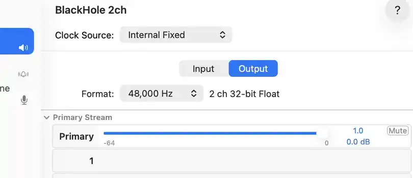
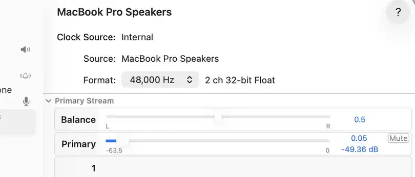

# ISLA — Let the Music Flow.

**LIVE Remastered and easier setup:** the LIVE panel now offers **v4.0 Remastered LIVE** with 0–100% permitted depth. Paired Bluetooth outputs are labeled, and the device list refreshes after Stop. Bare song filenames can be found through Mac-wide Spotlight and media-folder search, including common `.ACC` / `.AAC` confusion. See [LIVE, Bluetooth routing and song discovery](docs/remastered/LIVE_AND_DISCOVERY.md).

**ALIVE + LIVE · Velvet · Legato · Melt**

[](https://github.com/dfeen87/ISLA/releases/latest)
[](https://github.com/dfeen87/ISLA/actions/workflows/alive.yml)
[](https://github.com/dfeen87/ISLA/actions/workflows/ci.yml)

[](pyproject.toml)
[](#live-listen-to-your-mac)
[](LICENSE)

**ISLA** is an open-source, local-first audio application and musical-processing research project. Use **ALIVE** to play and compare local recordings, or **LIVE** to hear Mac system audio through ISLA. The native **Audio Control Center** brings file playback, device setup, listening volume and processing modes into a clickable window.

Choose **Original / Bypass**, the established **Velvet / Legato / Melt** profiles, or opt into the **v4.0 Remastered research engines** in ALIVE and LIVE. Remastered intensity controls permitted DSP depth—not loudness. Results are experimental; audible improvement has **not** been established.

**Author:** Don Michael Feeney Jr. · **License:** [MIT](LICENSE)

**Dedicated to Isla, the creator's niece.** Her name is a reminder that expressive music and thoughtful engineering belong together.

> **Source version: 4.0.0 — Remastered research candidate (not yet released).** Python package, HTTP API and JUCE/CMake metadata are aligned at 4.0.0. The source includes opt-in Experiment 02 Remastered modes for ALIVE and LIVE, DRM-free Apple-purchase import, Bluetooth-device improvements and local-song discovery. Existing production DSP, ALIVE/LIVE transport safeguards and frozen Experiment 02 research remain protected. **Native Mac/creator listening acceptance is pending.** The latest published GitHub Release remains [v3.3.0](https://github.com/dfeen87/ISLA/releases/tag/v3.3.0); a source-version change does not publish v4.0.0.

**Start here:** [Install and open Control Center](#get-started-on-macos) · [ALIVE local music](#alive-play-a-local-audio-file) · [LIVE system audio](#live-listen-to-your-mac) · [Remastered research](#remastered-research-alive-and-live) · [Troubleshooting](#troubleshooting)

**Reference:** [ALIVE Remastered mathematics](docs/remastered/IMPLEMENTATION.md) · [LIVE Remastered and device/song discovery](docs/remastered/LIVE_AND_DISCOVERY.md) · [Terminal commands](#terminal-command-reference) · [Electronic listening comparisons](#hear-the-difference) · [Research and legacy history](#engineering-and-evidence) · [Published releases](https://github.com/dfeen87/ISLA/releases)

**Research and release status:** `main` identifies itself as source version **4.0.0**, but the latest published GitHub release is **v3.3.0**. Remastered remains an opt-in engineering preview with native listening acceptance outstanding and the frozen Experiment 02 verdict **REVISE / INCONCLUSIVE**. See the [current feature guide](#remastered-research-alive-and-live) before interpreting historical v3.x audio comparisons.

## Table of contents

Find a feature, set up an audio path, or jump straight to the engineering history. Every link targets a section in this README.

- [What ISLA does](#what-isla-does)
  - [Remastered research: ALIVE and LIVE](#remastered-research-alive-and-live)
  - [Why this exists](#why-this-exists)
- [Remastered listening showcase](#remastered-listening-showcase)
  - [Mozart: Lacrimosa](#mozart-lacrimosa)
  - [Saint-Saëns: Organ Symphony finale](#saint-saëns-organ-symphony-finale)
- [Get started on macOS](#get-started-on-macos)
  - [1. Clone ISLA](#1-clone-isla)
  - [2. Prepare the Python environment](#2-prepare-the-python-environment)
- [User Interface](#user-interface)
- [ISLA Control Center — Graphical Interface](#isla-control-center--graphical-interface)
  - [Install and launch: which prompt are you using?](#install-and-launch-which-prompt-are-you-using)
    - [Option 1 — Launch the GUI from macOS Terminal](#option-1--launch-the-gui-from-macos-terminal)
    - [Option 2 — You already see `isla>`](#option-2--you-already-see-isla)
  - [ALIVE — play a local audio file](#alive--play-a-local-audio-file)
  - [LIVE — guided Mac system audio](#live--guided-mac-system-audio)
  - [Readiness, troubleshooting and shutdown](#readiness-troubleshooting-and-shutdown)
- [LIVE: Listen to your Mac](#live-listen-to-your-mac)
  - [1. Install Homebrew if needed, then BlackHole 2ch](#1-install-homebrew-if-needed-then-blackhole-2ch)
  - [2. Set up the physical output and BlackHole routing](#2-set-up-the-physical-output-and-blackhole-routing)
    - [BlackHole 2ch and macOS output volume — keep physical output low](#blackhole-2ch-and-macos-output-volume--keep-physical-output-low)
  - [Visual guide — BlackHole at unity, Mac speaker volume kept low](#visual-guide--blackhole-at-unity-mac-speaker-volume-kept-low)
  - [Bluetooth stereo speakers / headphones (experimental)](#bluetooth-stereo-speakers--headphones-experimental)
  - [3. Launch ISLA and confirm Bypass](#3-launch-isla-and-confirm-bypass)
  - [Built-in Terminal help — ISLA Audio Control Command Center](#built-in-terminal-help--isla-audio-control-command-center)
  - [4. Compare Velvet, Legato, Melt and Bypass](#4-compare-velvet-legato-melt-and-bypass)
  - [5. Exit and restore normal Mac audio](#5-exit-and-restore-normal-mac-audio)
- [ALIVE: Play a local audio file](#alive-play-a-local-audio-file)
  - [Export without the interactive player](#export-without-the-interactive-player)
- [Professional terminal help](#professional-terminal-help)
- [Terminal command reference](#terminal-command-reference)
- [Troubleshooting](#troubleshooting)
- [Privacy and practical limits](#privacy-and-practical-limits)
- [Engineering and evidence](#engineering-and-evidence)
  - [Inspiration](#inspiration)
  - [Hear the Difference](#hear-the-difference)
    - [Hinkik — Outbreaker](#hinkik--outbreaker)
    - [Kubbi — Ember](#kubbi--ember)
  - [Current acceptance, roadmap and historical milestones](#current-acceptance-roadmap-and-historical-milestones)
- [🤝 Contributing](#-contributing)
- [📜 License](#-license)
- [🙏 Acknowledgements](#-acknowledgements)
  - [🎹 A Special Night for ISLA — October 23, 2026](#-a-special-night-for-isla--october-23-2026)

---

## What ISLA does

**After installing the GUI extra** ([steps below](#get-started-on-macos)), launch the Control Center from your Mac's Terminal:

~~~bash
python -m isla window
~~~

Alternatively, use `isla window` in the activated environment. The Control Center now opens **full screen** by default; on macOS, use **Control + Command + F** to switch back to a regular window. For the classic interactive `isla>` prompt, run `python -m isla`. **A standalone `.app`/DMG installer is not published yet.**

ISLA was inspired by how slowing a piano recording can expose abrupt note attacks and resonances. It explores whether software can make those transitions feel softer and more connected without losing the character of the performance.

**Choose your way to listen:**

| Experience | What you hear | Additional setup |
|---|---|---|
| **LIVE — Mac system audio** | YouTube, browser audio, and other sound sent through ISLA to your speakers/headphones | **BlackHole 2ch** virtual audio device; macOS audio routing |
| **ALIVE — Local file player** | Load local files including eligible DRM-free Apple purchases; compare Original, production modes and opt-in Remastered | No BlackHole required |
| **Offline export** | Process a local file with the existing production CLI/Python API | No BlackHole required |
| **Remastered research** | Control governed Velvet, Legato or Melt processing depth in ALIVE or continuous LIVE | ALIVE: supported short excerpts; LIVE: same BlackHole routing as above |

**Three established musical profiles, plus Bypass**

| Mode | Listening intention |
|---|---|
| **Velvet** | Gentler harmonic texture and less sharp-feeling attacks |
| **Legato** | A more connected musical impression between notes |
| **Melt** | A more pronounced, flowing harmonic texture |
| **Bypass** | The original input audio, without ISLA's smoothing |

These are **creative goals**, not guarantees. The **original production** LIVE modes share a continuous harmonic-processing structure; the production ALIVE/offline processor has a different file-processing pipeline. They do **not** produce identical results. The separate **Remastered research** engines implement governed Experiment 02 mechanisms and must not be confused with the original production presets. Compare everything against Bypass at comfortable, comparable loudness.

Bypass keeps the decoded original in ALIVE and a time-aligned copy of the captured input in LIVE. It does not remove LIVE's monitoring delay. Processing is not loudness-normalized, so a louder mode is not necessarily a better one.

### Remastered research: ALIVE and LIVE

**Depth control:** 0–100% in **5% steps**. At **0%**, Remastered selects the original source (subject to LIVE's existing delay); at **100%**, it uses the frozen Experiment 02 governed baseline depths. Intermediate settings scale only permitted DSP control and its recovery allowance. They are **not** wet/dry mix, a volume knob or a guarantee of audible intensity.

- **Experimental Remastered ALIVE:** Open a local mono/stereo **WAV excerpt** at **44.1 or 48 kHz, up to 30 seconds**; expand **Show v4.0 Remastered (Experimental ALIVE)**, choose the mode and intensity, then **Prepare / Apply Remastered**. While preparation is running, use **Cancel Preparation** to preserve the current audio. This creates a validated playback buffer without changing the original file. A hot recording may be rejected by the 0.98 peak screen even at 0%; Original remains available.
- **LIVE preview:** With BlackHole and a verified physical listening output configured, choose **v4.0 Remastered LIVE** in Step 4, set depth, apply the engine and choose Velvet, Legato or Melt. The same governed equations run continuously in the existing worker, **without ALIVE's 30-second excerpt limit**. The LIVE Listening Volume control is separate from research depth. Stop and lower the source level if an audio-safety guard triggers.

The frozen research verdict remains **REVISE / INCONCLUSIVE**. Numerical equivalence and hosted GUI tests do **not** establish superior sound, hard real-time guarantees or completed physical Mac/Bluetooth listening acceptance. Read the [ALIVE research implementation](docs/remastered/IMPLEMENTATION.md) and [LIVE research/device guide](docs/remastered/LIVE_AND_DISCOVERY.md).

### Why this exists

*What if musical notes could transition with engineered softness, even in instruments that don't naturally provide it?*

ISLA began as **Phased-Music-Notes** and evolved through a regression-tested BEDROCK DSP foundation into a usable terminal player and experimental live-audio monitor.


## Remastered listening showcase

**Two classical performances. Three Remastered modes. Two listening speeds.** Compare **Velvet**, **Legato**, and **Melt** against **Original / Bypass** using the same passage from each recording. All processed examples use the current **v4.0 Remastered governed engine at 100% research depth**.

**Start with your listening volume low.** Each link opens or downloads a **24-bit FLAC**; if your browser downloads it, open it in your audio player. Compare one row at a time, then return to Original. The four modes at both speeds are matched to the same integrated loudness **within each work**, so keep your playback volume fixed.

**100% speed** gives an **18-second** excerpt; **60% speed (0.60×)** expands the same passage to **30 seconds**, with pitch preserved. The slower source is prepared **before** each model runs, letting its state-aware processing respond to the slower attacks, sustains, and decays. Listening speed and research depth are separate settings.

### Mozart: Lacrimosa

**Wolfgang Amadeus Mozart — Requiem in D minor, K. 626, “Lacrimosa.”** Piano transcription by **Sigismund Thalberg**, performed by **Lệ Xuân**. This piano arrangement offers note attacks, overlapping resonance, and decaying chords to explore. Passage: **00:12–00:30** of the source recording.

| Mode | Normal · 100% speed · 18 s | Slowed · 60% speed · 30 s |
|---|---|---|
| **Original / Bypass** | [▶ Listen / download](docs/audio/mozart-remastered/100pct-bypass.flac?raw=1) | [▶ Listen / download](docs/audio/mozart-remastered/060pct-bypass.flac?raw=1) |
| **Velvet Remastered** | [▶ Listen / download](docs/audio/mozart-remastered/100pct-velvet.flac?raw=1) | [▶ Listen / download](docs/audio/mozart-remastered/060pct-velvet.flac?raw=1) |
| **Legato Remastered** | [▶ Listen / download](docs/audio/mozart-remastered/100pct-legato.flac?raw=1) | [▶ Listen / download](docs/audio/mozart-remastered/060pct-legato.flac?raw=1) |
| **Melt Remastered** | [▶ Listen / download](docs/audio/mozart-remastered/100pct-melt.flac?raw=1) | [▶ Listen / download](docs/audio/mozart-remastered/060pct-melt.flac?raw=1) |

Recording and adapted audio: **[CC BY-SA 4.0](https://creativecommons.org/licenses/by-sa/4.0/)**. [Original recording and performer credit](https://commons.wikimedia.org/wiki/File:Mozart,_Requiem_in_D_minor,_%27Lacrimosa%27_%E2%80%93_piano_arrangement.ogg).

### Saint-Saëns: Organ Symphony finale

**Camille Saint-Saëns — Symphony No. 3 in C minor, Op. 78, “Organ,” Maestoso finale** (often tracked as the **4th movement**). **Stellar Brass of the United States Air Force Academy Band** performs **Gary Poffenbarger’s brass-and-organ arrangement**, from *Fireworks for Brass and Organ* (2007). Explore the opening’s sustained organ sonority and brass texture. Passage: **00:00–00:18** of the source track.

| Mode | Normal · 100% speed · 18 s | Slowed · 60% speed · 30 s |
|---|---|---|
| **Original / Bypass** | [▶ Listen / download](docs/audio/saint-saens-remastered/100pct-bypass.flac?raw=1) | [▶ Listen / download](docs/audio/saint-saens-remastered/060pct-bypass.flac?raw=1) |
| **Velvet Remastered** | [▶ Listen / download](docs/audio/saint-saens-remastered/100pct-velvet.flac?raw=1) | [▶ Listen / download](docs/audio/saint-saens-remastered/060pct-velvet.flac?raw=1) |
| **Legato Remastered** | [▶ Listen / download](docs/audio/saint-saens-remastered/100pct-legato.flac?raw=1) | [▶ Listen / download](docs/audio/saint-saens-remastered/060pct-legato.flac?raw=1) |
| **Melt Remastered** | [▶ Listen / download](docs/audio/saint-saens-remastered/100pct-melt.flac?raw=1) | [▶ Listen / download](docs/audio/saint-saens-remastered/060pct-melt.flac?raw=1) |

[Source recording, arrangement and U.S. public-domain notice](https://commons.wikimedia.org/wiki/File:Symphony_No._3_in_C_Minor_-_II._Maestoso_-_Stellar_Brass_-_United_States_Air_Force_Academy_Band.mp3). Performer credit identifies the source; no endorsement is implied.

These are **offline Remastered listening examples**; the frozen research verdict remains **REVISE / INCONCLUSIVE**. Differences may be subtle, and preference is yours to assess. FLAC avoids further lossy encoding; the supplied recordings were already compressed. See the [credits, exact method and reproduction instructions](docs/audio/CLASSICAL_SHOWCASE.md), plus measured [Mozart](docs/audio/mozart-remastered/PROVENANCE.json) and [Saint-Saëns](docs/audio/saint-saens-remastered/PROVENANCE.json) render reports.

## Get started on macOS

Use these instructions on a Mac with **Python 3.10+** and Git. LIVE targets macOS **13+**, requires a **separate stereo physical output**, and has been tested on an Apple Silicon Mac; broader compatibility is not yet established. Instructions below assume you clone into your home directory.

### 1. Clone ISLA

In **Terminal**:

~~~bash
cd ~
git clone https://github.com/dfeen87/ISLA.git
cd ISLA
~~~

### 2. Prepare the Python environment

Check your Python version before creating the environment:

~~~bash
python3 --version
~~~

Use **Python 3.10 or newer**. If it is missing or older, install a suitable version from [Python's macOS downloads](https://www.python.org/downloads/macos/), reopen Terminal, return to `~/ISLA`, and check again. Python 3.10/3.13 are covered by the repository's ALIVE CI matrix; the native acceptance report records Python 3.14.6.

Then, from your `ISLA` checkout:

~~~bash
python3 -m venv .venv
source .venv/bin/activate
python -m pip install -e '.[gui]'
~~~

The editable GUI installation provides the `isla` command, NumPy, SciPy, SoundFile, PortAudio playback and the PySide6 control window. It **does not** install BlackHole. No DAW, VST or JUCE build is needed to run ISLA. For a lighter **terminal-only** install, use `python -m pip install -e '.[playback]'` instead.

**Verify that the installation completed successfully** (still at your Mac's shell prompt, with `(.venv)` active):

~~~bash
python -m pip show isla-audio
isla --version
# Or, equivalently: python -m isla --version
~~~

You should see package information including `Name: isla-audio` and `isla 4.0.0` for the current source checkout. If the package is not found, check the output of `python -m pip install -e '.[gui]'` and rerun it from `~/ISLA`. Using `python -m pip` installs into the same Python environment you'll use to launch ISLA. A pip `[notice]` suggesting `pip install --upgrade pip` is optional and does not indicate an ISLA installation error.

The environment must be activated in each new Terminal session. **Open the graphical Control Center** with `python -m isla window` or `isla window`. To use the classic terminal interface, run `python -m isla`; for **local audio files only**, continue to [ALIVE](#alive-play-a-local-audio-file). BlackHole is unnecessary for ALIVE.

## User Interface

<p align="center">
  
  <br>
  <sub><em>Historical screenshot of the first Control Center. Current source also includes Remastered research controls and improved LIVE device selection, which are not shown in this image.</em></sub>
</p>

## ISLA Control Center — Graphical Interface

The optional **ISLA — Audio Control Center** provides clickable ALIVE playback, guarded Remastered depth controls in both ALIVE and LIVE, Bluetooth-capable device selection, local music loading, and guided LIVE setup. The original terminal and production offline exporter remain available. **This is a Python/PySide6 application, not yet a standalone Mac installer;** physical macOS GUI/audio and creator-listening acceptance of the latest research paths are pending.

### Install and launch: which prompt are you using?

**macOS Terminal and ISLA's interactive terminal accept different commands.** Look at the prompt before typing or pasting:

| Prompt you see | Where you are | What to type |
|---|---|---|
| `(.venv) ... ISLA %` (or a shell prompt ending in `%` / `$`) | **macOS Terminal (shell)** | `python -m pip install -e '.[gui]'`, `python -m isla window`, or `isla window` |
| `isla>` | **Inside the ISLA application** | **`window`** (one word), or `exit` to return to macOS Terminal |

**Do not paste a shell command such as `python -m isla window`, `isla window`, `python -m pip ...`, or `git pull` after `isla>`.** ISLA interprets those as its own audio commands, resulting in errors such as `Unexpected arguments for python`. Likewise, do not paste command examples' `#` comment lines or the printed prompt (`isla>`) as commands.

#### Option 1 — Launch the GUI from macOS Terminal

At your Mac's **shell prompt** (`ISLA %`, **not** `isla>`), enter these commands one line at a time. This example assumes you cloned ISLA to `~/ISLA` and created `.venv` as instructed above:

~~~bash
cd ~/ISLA
git switch main
git pull --ff-only
source .venv/bin/activate
python -m pip install -e '.[gui]'
python -m isla window
~~~

The `git pull --ff-only` step obtains the latest merged Control Center code; if Git reports uncommitted local changes or a pull conflict, resolve or preserve your changes before proceeding. If your checkout lives elsewhere, change the `cd` path accordingly. If you already updated the repository and installed `.[gui]`, you can skip the update/install steps and simply launch.

**Alternative shell launch:** `isla window` opens the same GUI after installation. Choose **either** `isla window` **or** `python -m isla window`; you do not need to run both. A shell-launched window closes back to the macOS shell.

#### Option 2 — You already see `isla>`

Inside an existing ISLA session, type **only** this command, then press Return:

~~~text
window
~~~

Do not include the `isla>` prompt itself and do not type `python -m isla window`. The window borrows the **existing controller, prepared buffers and LIVE monitor**, rather than starting a second audio engine. Finish or cancel a pending `setup audio` device-choice prompt first. Current playback/monitoring is preserved when entering the window; closing it stops audio and returns to `isla>` with any already prepared file retained. Pending file preparation is canceled on close.

**If `window` is not recognized or the optional GUI dependency is missing:** type `exit` to leave ISLA. Once you see your Mac's shell prompt again, run the update and `.[gui]` installation commands from Option 1, then launch the window. Run `exit` at `isla>`—not a shell `python`, `git`, or `pip` command.

The optional `gui` extra installs `PySide6-Essentials>=6.8,<7` (Qt Widgets) and `sounddevice>=0.5,<0.6`. Existing base and `.[playback]` installations do not import or require Qt. See the [Qt installation requirements](https://doc.qt.io/qtforpython-6/gettingstarted.html) and [dependency licenses](https://doc.qt.io/qtforpython-6/licenses.html). ISLA remains MIT licensed; Qt/PySide retain their own licenses and notices. No standalone bundled Mac app or installer is supplied.

### ALIVE — play a local audio file

1. Click **Open Audio File…** and select a non-empty mono/stereo recording (WAV, or a DRM-free purchased M4A / AAC or Apple Lossless file on macOS). Preparation runs outside the window thread using the existing cancellable preparation process.
2. Wait for **File ready**. Until then, Play and mode controls are disabled and the status explains what is happening.
3. Click **Play**, **Pause**, or **Stop**. Position and duration update automatically. Select **Velvet**, **Legato**, **Melt**, or **Original / Bypass** to compare the existing prepared buffers and transitions.
4. While stopped, choose an eligible listening output and click **Use Listening Output**. This output is shared with LIVE. On macOS, dropdown choices require verified physical stereo devices; the system default remains usable for ALIVE even when BlackHole is absent.

**Save Mix (Control Center):** Open **Experimental ALIVE** and choose **Save Mix…** to export the *currently selected, fully prepared* Original, Velvet, Legato, Melt, or validated Remastered mode as a **new lossless 32-bit float WAV**. This also works for normal full-length ALIVE modes (the 30-second limit applies only to Remastered ALIVE preparation). Saving runs in the background; **Cancel Save** abandons the unfinished output, and existing files are never overwritten. The exported audio is the prepared processing buffer **without the 25% listening-only volume attenuation**. **Saved WAVs may play louder in other apps—start with device volume low.** ISLA does not mix multiple tracks or export LIVE system audio through this command.

**ALIVE listening level (Control Center):** Every click of **Play** automatically sends ALIVE audio at **25% linear software output amplitude** (approximately **−12 dB**) before it reaches the selected device. This applies to Original / Bypass and the Velvet, Legato, Melt, and prepared Remastered playback buffers. It does **not** change the Mac's hardware/system volume, LIVE listening level, source file, or DSP calculations. **Terminal-only ALIVE playback is unchanged** and does not automatically use this GUI attenuation. Start with headphones and speakers low: 25% digital amplitude is **not** a guarantee of safe acoustic loudness.

Stop LIVE before opening a file. Stop file playback before changing devices or applying LIVE setup. **ALIVE's Remastered research panel** is separate from the three prepared production buffers; it offers 0–100% processing depth for eligible short excerpts and is not a gain or slowdown control.

### LIVE — guided Mac system audio

Install standalone **BlackHole 2ch** separately using the [LIVE instructions below](#live-listen-to-your-mac). Then:

1. **Capture Source:** choose **BlackHole 2ch**.
2. **Physical Listening Device:** choose your verified stereo speakers/headphones, such as MacBook Pro Speakers or External Headphones when present. Select **44,100** or **48,000 Hz**, then click **Apply LIVE Devices / Select LIVE Source**. Virtual, Aggregate, Multi-Output, ambiguous and mono sinks are excluded.
3. **macOS Sound Routing:** inspect the detected current system output. Click **Open Sound Settings**, then manually select **BlackHole 2ch** in macOS Sound → Output. Return and click **Recheck Audio Routing**. If the button cannot open the pane, use Apple menu → System Settings → Sound → Output.
4. Click **Start LIVE** to begin in **Original / Bypass**. Use the **LIVE sound effect** dropdown to choose Velvet, Legato, Melt or Original; **Reset to Original** restores Bypass. Effect changes do not stop or restart the stream. The interface shows pending and confirmed mode selections and exposes any safety-stop reason. Use the separate **LIVE Listening Volume** control to attenuate physical listening output (0–100%, with Apply Volume and Mute/Unmute); it never adjusts BlackHole capture, macOS master volume or other applications. **Stop LIVE** releases the stream before deferred device discovery. See [device and session behavior](docs/remastered/LIVE_AND_DISCOVERY.md) and the [detailed Control Center checklist](docs/control-center/ACCEPTANCE.md).
5. **Optional v4.0 Remastered LIVE:** Choose **v4.0 Remastered LIVE** in the engine selector, set **0–100% permitted depth in 5% increments**, then click **Apply LIVE Engine / Depth** (or release the slider). Choose Velvet, Legato or Melt in the effect dropdown. This is governed **processing depth, not listening volume**: 0% is Original and 100% is the research baseline. The original profiles are still available under **Original LIVE profiles**. The existing LIVE stream and routing protections stay in effect. Read the [research limitations](docs/remastered/LIVE_AND_DISCOVERY.md#verification-and-scientific-scope).

Required arrangement:

~~~text
macOS Sound Output:     BlackHole 2ch
ISLA Capture:           BlackHole 2ch
ISLA Physical Playback: your selected physical speakers/headphones
~~~

System audio enters BlackHole, ISLA processes it, then ISLA plays it through your physical listening device. **Keep the physical device selected inside ISLA; select BlackHole as the macOS default during LIVE.** ISLA does not change macOS defaults or create a Multi-Output device. Start revalidates device identities, stereo/rate support, routing and actual opened stream handles even after a successful Recheck. The existing recovery limits, fail-closed routing and DSP safeguards remain active.

### Readiness, troubleshooting and shutdown

| Window message or condition | Next action |
|---|---|
| **Open an audio file to begin** | Open a local audio file and wait for preparation; playback/mode buttons will then become available. |
| **LIVE is not ready**, current output is External Headphones | Open Sound Settings, select **BlackHole 2ch**, return and Recheck. Keep the desired physical listening output inside ISLA. |
| BlackHole missing, ambiguous, or no eligible output | Check Audio MIDI Setup, reconnect the device and click **Refresh Devices**. Apply a fresh selection. |
| Device identity changed, stale PortAudio devices, or unplugged headphones | Stop audio, Refresh, select devices again and Recheck. If opened native IDs still disagree, close ISLA and relaunch to refresh PortAudio. |
| Start LIVE disabled after switching back to ALIVE | Stop playback and click **Apply LIVE Devices / Select LIVE Source** again. |
| Preparation fails | Read the adjacent error, choose a valid smaller mono/stereo audio file and retry. Close cancels preparation. |
| Audio command takes over ten seconds | The window remains responsive and explains the delay. Close requests cleanup after the operation returns. Commands stay locked to prevent a competing engine. |
| Cleanup reports a still-stopping audio worker | The window retains session ownership. Retry Close after it stops; it will not return a busy controller to the terminal. A permanently blocked native driver may require process termination; do not start another audio session. |

After LIVE stops or the window closes, **restore your normal macOS Sound Output** if it still points to BlackHole; otherwise ordinary Mac audio can remain silent. Closing never rewrites system settings. A retained reminder is also shown in the LIVE panel. Use **Close Window / Return to CLI**, the native close control, or the desktop Quit action for cleanup. The window supports native keyboard focus/navigation, Open (Cmd+O on macOS) and Close (Cmd+W).

For traditional operation, continue using `isla` or `python -m isla`. Existing offline export syntax remains:

~~~bash
isla --input input.wav --output output.wav --mode velvet
~~~

LIVE remains experimental and macOS-only, targeting macOS 13+ and a separate physical stereo output. Qt's platform support and the selected wheel also determine GUI OS compatibility. Linux offscreen tests and hosted macOS widget tests do not establish physical Mac, permission-dialog, listening or Bluetooth acceptance. Qt provides a possible future Windows UI boundary; **Windows LIVE capture/routing is not implemented**. See the [control mapping, verification and native checklist](docs/control-center/ACCEPTANCE.md).

## LIVE: Listen to your Mac

Complete the Python setup above first. These steps route browser and other Mac audio through ISLA.

### 1. Install Homebrew if needed, then BlackHole 2ch

LIVE needs a virtual cable between macOS sound and ISLA. **BlackHole 2ch is a virtual audio device, not an app to launch.** ISLA does not install or bundle it.

The recommended route is [Homebrew](https://brew.sh/). Its [current macOS requirements](https://docs.brew.sh/Installation#macos-requirements) are separate from ISLA's macOS 13+ target. Check whether it is installed:

~~~bash
brew --version
~~~

If `brew` is missing, follow the instructions at [brew.sh](https://brew.sh/). Their published installer command is:

~~~bash
/bin/bash -c "$(curl -fsSL https://raw.githubusercontent.com/Homebrew/install/HEAD/install.sh)"
~~~

Follow Homebrew's post-install **Next steps** to put `brew` on your shell path and confirm that `brew --version` works. Then install **BlackHole 2ch**, not 16ch:

~~~bash
brew install --cask blackhole-2ch
~~~

**Restart your Mac after installing BlackHole.** The [Homebrew BlackHole 2ch cask](https://formulae.brew.sh/cask/blackhole-2ch) requires a reboot. Then open **Applications → Utilities → Audio MIDI Setup → Window → Show Audio Devices** and confirm that **BlackHole 2ch** appears.

If you prefer not to use Homebrew—or your system is not supported by current Homebrew releases—use the [official BlackHole installer](https://existential.audio/blackhole/) instead. The required audio device remains **BlackHole 2ch**.

### 2. Set up the physical output and BlackHole routing

#### BlackHole 2ch and macOS output volume — keep physical output low

**IMPORTANT — do not turn your Mac's system output up to 100% as a BlackHole setup step.** macOS volume commands affect whichever output is currently selected (when the device supports volume changes). If that output is your headphones or speakers, you could hear unexpectedly loud audio. Pause the source, lower your physical listening device and source-app volume, and start ISLA's separate **LIVE Listening Volume** low.

**BlackHole unity is a separate, device-specific setting.** In **Audio MIDI Setup**, select **BlackHole 2ch**, inspect its **Output** controls, and use **Primary 1.0 / 0.0 dB** only if that adjustable control is available. Unity means *no amplification or attenuation* within that BlackHole control; it does **not** require, imply, or verify 100% hardware/headphone volume. Some virtual devices do not expose adjustable channel sliders, and macOS output-volume commands cannot be relied upon to configure BlackHole's per-channel gain.

**Do not use a generic Terminal command to raise macOS output volume to 100% while following these instructions.** Instead, verify the selected device directly in Audio MIDI Setup, keep your actual listening output low, and confirm that ISLA captures BlackHole while playing through your chosen physical speakers/headphones. The annotated screenshots immediately below show the intended distinction.

### Visual guide — BlackHole at unity, Mac speaker volume kept low

These are **actual macOS Audio MIDI Setup screenshots** from the ISLA development setup, cropped to focus on device controls. The numbers below describe these screenshots; they are not universal defaults.

**1. Configure BlackHole 2ch for clean system-audio capture.**



- In **Applications → Utilities → Audio MIDI Setup**, select **BlackHole 2ch** on the left and click **Output**.
- Leave **48,000 Hz / 2 ch 32-bit Float** if that matches the ISLA LIVE configuration and your physical output; otherwise explicitly match both devices at the supported rate.
- Set the **Primary** slider to **1.0 / 0.0 dB**, as shown. This is unity gain (no attenuation or boost), **not** a command to set your Mac's physical-speaker volume to 100%.
- Keep **Mute** off. Channels 1 and 2 may not have separately editable controls.

**2. Keep the physical MacBook speakers at a comfortable level.**



- Select **MacBook Pro Speakers** on the left. Keep **Balance** centered at **0.5** and the format at **48,000 Hz** where supported.
- The screenshot's **Primary** slider is **0.05 / −49.36 dB**, which is a *low device-level setting in this example*. **It is not equivalent to 25% on the macOS volume slider.** Set your own speakers/headphones to a comfortably low level; do **not** move the physical-output slider to 0 dB merely to match BlackHole.
- Selecting a device in Audio MIDI Setup does **not** necessarily make it the macOS default. To adjust the Mac's own output, select the intended physical device in **System Settings → Sound → Output** first.

**3. Lower macOS alert sounds independently.** At your regular macOS shell prompt (not `isla>`), run:

~~~bash
osascript -e 'set volume alert volume 25'
osascript -e 'get volume settings'
~~~

The `alert volume:25` reading confirms the macOS alert-volume setting; **it does not describe BlackHole's 0 dB level or the speaker slider shown above**. In **System Settings → Sound → Sound Effects**, also review **Play sound effects through** and **Alert volume**. If the physical output needs adjustment, select it in macOS Sound settings first and use `osascript -e 'set volume output volume 25'` or its physical volume keys at a safe starting level.

**4. Check the LIVE audio path before pressing Start LIVE.** macOS **Sound → Output** should be **BlackHole 2ch** for system capture; inside ISLA, **Input = BlackHole 2ch** and **Physical Listening Output = External Headphones or MacBook Pro Speakers** (never BlackHole). Start ISLA's LIVE Listening Volume low and raise it gradually. Pause audio before making large gain changes. Stop LIVE and restore your ordinary Mac output when finished.

> **Safety:** Generic macOS output-volume changes affect whichever default output supports that control; they **do not** independently establish BlackHole unity. Avoid raising the macOS output to 100% during setup. For BlackHole, inspect the separate **0.0 dB Primary** control shown in Photo 1 (where available); keep the physical listening device at a low, comfortable level.

**Do this before starting LIVE monitoring:**

1. In **System Settings → Sound → Output**, note your **normal physical output** (such as `MacBook Pro Speakers` or `External Headphones`). Set a comfortable volume on that physical device **before** switching outputs.
2. In **Audio MIDI Setup**, set **BlackHole 2ch** to **48,000 Hz / 2 channels**. Use a physical output that supports stereo at the same rate. To use 44,100 Hz instead, match both device formats to that rate and later start with `monitor start 44100`.
3. In **System Settings → Sound → Output**, manually choose **BlackHole 2ch**. **Your Mac may now sound silent: that is expected.** ISLA will be the audio monitor that sends the captured sound to your physical output.
4. **Do not use a Multi-Output or Aggregate Device, or another monitor that also sends the browser audio directly to the speakers.** You could otherwise hear delayed/doubled audio or create a feedback loop.

The intended path is:

~~~text
YouTube / Mac system audio → BlackHole 2ch → ISLA LIVE → physical speakers / headphones
~~~

ISLA deliberately **does not change the macOS default sound output automatically**. You must restore that setting when finished.

### Bluetooth stereo speakers / headphones (experimental)

Bluetooth speakers and headphones can be selected as ISLA's **physical stereo output**, if Core Audio and PortAudio both identify a unique, connected stereo device that accepts 44.1 or 48 kHz. Current Step 2 can label eligible paired outputs **(Bluetooth)**, and refreshed discovery after Stop helps when the device list changes. Wireless output is **not guaranteed**: Bluetooth adds device buffering, latency and possible clock drift/dropouts, so this is a listening convenience, **not** a low-latency or video-sync claim.

1. Pair and connect your Bluetooth speaker/headphones in **System Settings → Bluetooth**. Verify ordinary Mac playback first at a comfortable volume. If the device presents separate hands-free/mono and stereo profiles, choose the stereo output and do not use its microphone as ISLA's input.
2. With ISLA stopped, inspect its current `devices` list. Use `setup audio` to choose standalone **BlackHole 2ch** for input and the **exact listed Bluetooth stereo device** for output. Alternatively, use `source system`, `input "BlackHole 2ch"`, and `output "<exact listed Bluetooth device name>"` inside `isla>`. The name is discovered on your Mac; these commands do not pair hardware.
3. In **Audio MIDI Setup**, use matching supported stereo formats for BlackHole and the Bluetooth output where configurable. Try 48 kHz first; if unsupported, try 44.1 kHz with `monitor start 44100` after matching BlackHole. ISLA refuses unsupported device/rate combinations rather than silently changing them.
4. Manually set **macOS System Settings → Sound → Output** to **BlackHole 2ch**, *not* the Bluetooth speaker. The route is: Mac audio → BlackHole → ISLA LIVE → Bluetooth. Recheck the macOS default output after pairing or reconnecting, since macOS can switch it.
5. At `isla>`, run `bypass`, then `monitor start` (or `monitor start 44100`), and `status`. Confirm sound, output name and counter behavior before trying modes. Avoid other monitors or Multi-Output/Aggregate devices, which can produce doubled sound.
6. Stop ISLA **before** reconnecting, changing Bluetooth profiles or moving devices: `monitor stop`; reconnect, refresh `devices` and select the output again. If device listings remain stale, restart ISLA. Restore the usual Mac output in System Settings when finished.

If audio crackles, stops or feels substantially delayed, check `status` for underflows/overflows, test another supported rate, and use wired speakers/headphones for the more dependable baseline. No Bluetooth latency compensation, automatic handoff or native acceptance is claimed here.

### 3. Launch ISLA and confirm Bypass

**First, run these commands in macOS Terminal** (where your shell prompt usually ends in `%` or `$`). Reopen Terminal after the BlackHole restart, if needed:

~~~bash
cd ~/ISLA
source .venv/bin/activate
python -m isla
~~~

**`python -m isla` is the recommended first-run command.** After successful installation, you can also launch with the shorter `isla` console command if it is available in your activated environment.

If you instead enter `isla` and receive `zsh: command not found: isla`, **don't type `devices` into zsh**. Check the installation with `python -m pip show isla-audio`; if the package is missing, run these commands in `~/ISLA`:

~~~bash
python -m pip install -e '.[playback]'
python -m isla
~~~

If the module launches but `isla` is still not found, continue using `python -m isla` and investigate the console-script `PATH` later. If the module does not launch, read its error and recheck the Python environment and installation output.

When ISLA starts successfully, you'll see a message similar to this (your output-device name may differ):

~~~text
ISLA — ALIVE + LIVE
Audio Engine: Ready
Status: Idle
Type help for commands.
Output: External Headphones
isla>
~~~

### Built-in Terminal help — ISLA Audio Control Command Center

When the `isla>` prompt appears, type `help` (or `?`) to open ISLA's **context-aware command center**. The display groups ALIVE file playback, LIVE monitoring, device setup, troubleshooting and suggested next steps. The help screen is generated from your **current ALIVE/LIVE state**, so its device names, hints and suggested steps change with your session. Additional topics include `help live`, `help file`, `help devices`, `help modes` and `help troubleshoot`.

> **Tip:** Type `help` inside the `isla>` terminal to view the current DOS-inspired command center directly; no static screenshot is needed to follow these steps.

**First command inside ISLA: `setup audio`.** Once you see the `isla>` prompt, type this command and press Return (type only the command, **not** `isla>`):

~~~text
setup audio
~~~

The guided setup asks you to select **BlackHole 2ch** for capture and then **physical stereo speakers/headphones** for ISLA's playback output. At its `Select input` and `Select output` prompts, enter a listed device number or exact name. For example, select `0` for BlackHole and `1` for External Headphones **only if those numbers appear in your own list**. Type `cancel` to leave without changing the route. **Selecting the physical output inside ISLA is not the same as changing the Mac's system output.** The wizard saves `source system`, input and output inside ISLA, but **does not start monitoring or change macOS Sound settings**. To complete the route, manually select **BlackHole 2ch**, not your physical speakers, in macOS **System Settings → Sound → Output**; ISLA forwards the audio to your selected speakers. The LIVE guard rejects an unconfirmed single-path route rather than risking a duplicate/feedback path.

**Important — two different prompts:**

- **macOS Terminal / zsh:** `(.venv) (base) ... ISLA %` means you are still at your Mac's shell prompt. Running `devices` here produces `zsh: command not found: devices`.
- **ISLA:** `isla>` means the app is running. **Only here** can you use ISLA commands such as `devices`, `source system`, `monitor start`, and `mode melt`.

**Optional — number-only device pickers:** After `source system`, type `input` or `output` with no argument to open a filtered selection menu. At its `Select input` / `Select output` prompt, type **only the number shown** (or `cancel`). `input` lists verified BlackHole 2ch capture devices; `output` lists only verified physical stereo outputs. The indices come from the current device list and can change after plugging or unplugging hardware.

If you prefer to inspect all endpoints first, type `devices` at the normal `isla>` prompt:

~~~text
devices
~~~

The `devices` command **only displays a list; it does not open a selection menu**. The simpler guided commands are:

~~~text
source system
input
0
output
1
~~~

The example chooses `0` for BlackHole capture and `1` for External Headphones **only if those numbers appear in the displayed selection menus**. If MacBook Pro Speakers is listed as `3`, select `3` instead at the output picker. You can still enter `input "BlackHole 2ch"`, `output "External Headphones"`, or direct `input 0` / `output 1` at `isla>` with verified current indices.

A bare number is accepted **only when a picker is active**, never at the normal `isla>` command prompt. Do not append descriptions such as `default 48000 Hz`; sample rate is not a device-selection command. Microphones and BlackHole cannot be selected as LIVE playback outputs. Never choose BlackHole as the ISLA output. A startup line such as `Output: BlackHole 2ch` reflects the macOS default output, not your selected physical ISLA output.

**With either setup method**, after confirming macOS **System Settings → Sound → Output** is set to **BlackHole 2ch**, type:

~~~text
bypass
monitor start
status
~~~

Now play music in your browser—for example, [the Beethoven performance used in native testing](https://www.youtube.com/watch?v=UHd8jwXBzXE). This is source material, **not an ISLA before/after demo**. No audio download or WAV file is required. Confirm that **Bypass** is audible through the chosen physical output, with no echo or second unprocessed path. In `status`, look for **Monitor: Running** and nonzero input/output signal levels while music plays.

### 4. Compare Velvet, Legato, Melt and Bypass

Start with the **original production** profiles while music plays:

~~~text
mode velvet
mode legato
mode melt
bypass
status
~~~

To opt into the **experimental governed Remastered LIVE engine** instead, at the same `isla>` prompt use:

~~~text
engine remastered 50
mode melt
status
bypass
engine production
~~~

The `50` requests **50% permitted Remastered processing depth**, not 50% volume. Use 0–100 in steps of five. `engine production` returns to the existing harmonic profiles; production modes and their historical examples remain supported.

Allow a passage of music to play in each mode. These profiles change the harmonic processing; the musical effect can be subtle and depends on the material. The terminal remains responsive; `status` reports signal levels, device status and buffer counters. Reported latency is an ADC/DAC **timestamp estimate**, not an independently measured acoustic/video-sync delay.

### 5. Exit and restore normal Mac audio

Inside ISLA:

~~~text
monitor stop
exit
~~~

Pause the browser or music app. Then open **System Settings → Sound → Output** and **manually switch back to the physical output you noted in the routing setup**. ISLA cannot restore a manually changed system device on `exit`. If ISLA crashes, is force-quit, or your Mac becomes silent, reselect your physical output in macOS Sound settings.

**Permissions:** If capture is silent and macOS requests it, allow audio-input/microphone access to Terminal or the app running Python. Check **System Settings → Privacy & Security → Microphone**. LIVE uses BlackHole audio input, **not** screen recording or ScreenCaptureKit. It does not save or transmit captured system audio.

---

## ALIVE: Play a local audio file

**No Homebrew or BlackHole required for this mode.** Complete and verify the Python installation under [Get started](#get-started-on-macos), then select your ordinary speakers/headphones in macOS. In Terminal:

~~~bash
cd ~/ISLA
source .venv/bin/activate
python -m isla
~~~

You can also run `isla` when its installed console command is available.

From the `isla>` prompt:

~~~text
source file
load "~/Music/my piano.wav"
status
~~~

ISLA prepares the original recording plus Velvet, Legato, and Melt in a background process. Use `status` until it says **Preparation: Ready**; the terminal is still usable while processing. Then:

~~~text
play
mode velvet
mode legato
mode melt
bypass
pause
play
stop
exit
~~~

`play` resumes from pause or starts from the beginning after a stop or completed playback. `stop` resets position; `bypass` returns to the decoded original. Use a **real local file path** in place of the example. Quotes handle spaces, and `~` expands to your home directory. **New:** for a missing *bare filename*, such as `load "Dancing Queen.m4a"`, ISLA can search Spotlight and accessible local music folders; ambiguous matches require an explicit full path. Existing full paths are never silently replaced. See [local song discovery](docs/remastered/LIVE_AND_DISCOVERY.md#finding-a-local-song).

**Local audio formats:** mono or stereo **WAV**, plus **DRM-free M4A / AAC and Apple Lossless (ALAC) on macOS**, decoded with the built-in macOS audio converter. No extra decoder installation is needed on Mac. FLAC, AIFF, OGG and MP3 depend on the installed libsndfile. On other systems, export AAC / ALAC to a DRM-free WAV, FLAC or AIFF first. Preparation of long files uses more time, working memory and temporary storage; decoding stays in the cancellable preparation process and preserves the source sample rate and channels.

**Purchased music from Apple:** download the purchased track to your Mac in the Music app (iTunes Store purchases), then use **Show in Finder** to locate its local file. Open that `.m4a` file with **Open Audio File…**, or use `load "~/Music/path/to/Purchased Song.m4a"` at `isla>`. [Apple describes iTunes Plus purchases as DRM-free AAC](https://support.apple.com/en-ie/guide/music/mus3e2346c2/mac). The original file is left untouched. A cloud-only library entry must be downloaded first. Apple Music subscription downloads and older protected purchases (`.m4p` / `.movpkg`) cannot be imported into ALIVE; use a DRM-free purchased copy. This is local file playback; the offline export CLI retains its libsndfile format support.

### Export without the interactive player

The one-shot file-processing route is available using Python directly:

~~~bash
python -m isla --input input.wav --output output_isla.wav --mode velvet
~~~

When the short `isla` console command is available, `isla --input input.wav --output output_isla.wav --mode velvet` is equivalent.

Or in Python:

~~~python
from isla import SmoothPhase

engine = SmoothPhase(mode="velvet")
engine.smooth_file("input.wav", "output_isla.wav")
~~~

Use `velvet`, `legato`, or `melt`. The API is `smooth_file(input_path, output_path)`. Process recordings you own or have permission to use.

---

## Professional terminal help

At `isla>`, type `help` or `?` for the ASCII command center. It shows the current source, monitor, mode, and selected devices; LIVE commands appear first for System Audio and ALIVE commands first for File. Columns adapt to the terminal width, including plain-text pipes, without color requirements, clearing the screen, or continuous repainting. Help reads session state without scanning hardware.

| Topic | Guidance |
|---|---|
| `help live` | System capture, Start/Stop, modes and next steps |
| `help file` (also `help alive`) | Prepare and play a local audio file |
| `help devices` | Numbered pickers, BlackHole and physical outputs |
| `help modes` | Processing selection, Bypass and window reset |
| `help troubleshoot` | Mistaken commands, routing and recovery |

Example command-center excerpt (device names and operational values come from your session):

```text
+======================================================================+
|                               I S L A                                |
|                     AUDIO CONTROL COMMAND CENTER                     |
| CONTEXT : LIVE SYSTEM AUDIO                                          |
| SOURCE  : SYSTEM AUDIO                                               |
| MONITOR : RUNNING                                                    |
| MODE    : ORIGINAL / BYPASS                                          |
| INPUT   : BlackHole 2ch                                              |
| OUTPUT  : MacBook Pro Speakers                                       |
+----------------------------------------------------------------------+
| LIVE AUDIO                                                           |
|                                                                      |
| monitor start            Start LIVE when stopped (default 48000 Hz). |
| monitor stop             Stop LIVE and release audio devices.        |
| bypass                   Original input within the existing monitor. |
```

**LIVE** captures your Mac's ongoing application audio. Start music in the browser or music app; it is not a WAV file waiting for ISLA's `play` command. At `isla>`:

```text
source system
setup audio
monitor start
mode velvet
bypass
monitor stop
```

During `setup audio`, choose the listed BlackHole input and physical stereo output by number. Separately set macOS Sound Output to BlackHole as described in the [BlackHole routing guide](#2-set-up-the-physical-output-and-blackhole-routing), then start monitoring. The existing Audio MIDI screenshots, 0 dB BlackHole unity setting, low physical listening-volume precautions and separate macOS alert-volume instructions still apply.

**ALIVE** prepares and plays a local file. At `isla>`:

```text
source file
load "example.wav"
play
pause
stop
```

Wait for preparation to finish (`status`) before `play`. `play` during LIVE explains this distinction without opening another stream. Repeating `monitor start` reports the active mode without restarting LIVE. `bypass` keeps the monitor running on its unprocessed input path. Device changes are refused while running: use `monitor stop`, then `output`, choose a physical stereo device by number, recheck macOS routing and use `monitor start`. ISLA does not stop audio automatically to accommodate device selection.

Inside a numbered picker, help/topics remain available without consuming a device choice; use a listed number/exact name or `cancel`. `monitor stop` and `exit` remain available even during a picker or failed preparation. `status` retains full diagnostics and recovery counters with a short next-step hint.

## Terminal command reference

| Command | File source (ALIVE) | System source (LIVE) |
|---|---|---|
| `help [topic]` / `?` / `devices` / `status` / `exit` | Supported | Supported |
| `window` | Open the optional GUI using this session; close to return | Preserve the current monitor on entry; stop on close |
| `source file` / `source system` | Switch to file or system source | Switch to file or system source |
| `output "<name or index>"` | Select a device while stopped | Select a **physical** device while stopped |
| `input "BlackHole 2ch"` | Configure capture for LIVE | Select standalone BlackHole 2ch (the default capture name) |
| `load "<path>"` | Load and prepare local audio | Switch to `source file` first |
| `play` / `pause` | Start/resume or pause recording | Control the browser instead |
| `stop` | Stop and reset to beginning | Stops the live monitor |
| `monitor start [44100\|48000]` | Not applicable | Start capture and playback (default 48000); omit brackets when typing |
| `monitor stop` | Stops LIVE monitor if present | Stop LIVE monitoring |
| `mode velvet` / `mode legato` / `mode melt` | Select prepared production mode | Select profile within the chosen LIVE engine |
| `engine remastered 0..100` / `engine production` | LIVE-engine command; use the Control Center Remastered panel for ALIVE research | Opt into governed research depth (5% steps) or return to original LIVE profiles |
| `bypass` | Decoded original audio | Original captured system audio, time-aligned |

**The table above lists commands for the `isla>` prompt, not macOS shell commands.** For installation and GUI launch, see [which prompt are you using?](#install-and-launch-which-prompt-are-you-using). Shell commands such as `python -m isla window` belong at the Mac's `%` / `$` prompt.

Commands are case-insensitive where appropriate; file and device names retain their case. `Ctrl-C` or `Ctrl-D` at the terminal prompt also initiates cleanup. Switch devices **only while playback/monitoring is stopped**.

---

## Troubleshooting

| Symptom | What to check |
|---|---|
| **`Unexpected arguments for python`, `isla`, or `#`** | You probably pasted macOS shell commands inside `isla>`. Type `window` there, or type `exit` and run the install/launch commands at your Mac's shell prompt; see [the two prompts](#install-and-launch-which-prompt-are-you-using). |
| **`brew: command not found`** | Install Homebrew from [brew.sh](https://brew.sh/) and follow its post-install shell-path instructions. |
| **BlackHole already installed** | Homebrew's `Not upgrading blackhole-2ch, the latest version is already installed` message is informational. Continue to the audio-device setup. |
| **BlackHole not found** | Install the **2ch** cask, restart macOS, and confirm the device appears in **Audio MIDI Setup**. Run `devices` again in a freshly launched ISLA terminal. |
| **Mac goes silent after selecting BlackHole** | Expected until LIVE is monitoring. If you want ordinary sound back, select your physical speakers/headphones in **System Settings → Sound → Output**. |
| **LIVE is silent** | Confirm YouTube is playing, system output is **BlackHole 2ch**, ISLA input is BlackHole, ISLA output is the correct *physical* device, and input permission/volume are enabled. Use `status` to distinguish silent input from output problems. |
| **Echo, feedback or doubled sound** | Immediately run `monitor stop`. Remove Multi-Output routing, per-app direct speaker output and any other software monitor. Do not choose BlackHole as ISLA output. |
| **Device missing or disconnected** | Run `monitor stop`, reconnect the device, then `devices`; relaunch ISLA if Core Audio/PortAudio holds stale device information. No silent device fallback is provided. |
| **Crackling, glitches or noticeable delay** | Prefer built-in or wired speakers to Bluetooth, close busy apps, check matching 44.1/48 kHz device formats, and review `status` for underflows, overflows or device warnings. |
| **`zsh: command not found: isla`** | At the Mac's shell prompt, run `cd ~/ISLA`, `source .venv/bin/activate`, and `python -m pip show isla-audio`. If the package is missing, rerun `python -m pip install -e '.[playback]'`. Start with `python -m isla` and enter `devices` **only after** the `isla>` prompt appears. |
| **File won't load/play** | Use a valid downloaded local audio path (DRM-free for Apple purchases), wait for `Preparation: Ready`, check the physical output device and sample-rate/channel support. Protected Apple Music subscription downloads are not importable. |
| **Bare filename finds multiple songs** | Use `load "<full path>"` or the Control Center file picker; ISLA does not choose an ambiguous search match automatically. |
| **Remastered ALIVE render rejected** | Use a supported 44.1/48 kHz mono/stereo excerpt up to 30 seconds with enough peak headroom. Research preparation does **not** auto-attenuate or limit an over-peak source to pass the admission screen. Separately, **Control Center Play attenuates the outgoing ALIVE listening signal to 25%** once playback is allowed; this does not change the original file or research peak check. |
| **Bluetooth device disappeared** | Stop LIVE, reconnect the device in macOS, refresh the device list and reselect the verified physical stereo endpoint. The same device name alone is not trusted as identity. |

For deeper device diagnostics inside the activated environment, try `python -m sounddevice`. See [ALIVE/LIVE implementation and acceptance](docs/alive/IMPLEMENTATION_AND_ACCEPTANCE.md) for native test details and unresolved risks.

---

## Privacy and practical limits

- **Local processing:** The terminal player processes audio on your Mac without an account or cloud processing. LIVE keeps captured audio in memory and does not save or transmit it. ALIVE writes the decoded original and three prepared modes to an owned local temporary directory, removed on replacement or normal exit; forced termination can leave temporary files behind. Offline export writes the output file you request. Streaming sites and dependency installers have their own network behavior.
- **Experimental LIVE:** This Python/PortAudio implementation is not hard real-time. It targets macOS 13+ with standalone **BlackHole 2ch** and a **separate physical stereo output** at 44.1 or 48 kHz. Native evidence comes from one Apple Silicon Mac; it does not establish compatibility with every Mac, output device or OS version. Wired outputs avoid the extra delay associated with Bluetooth.
- **Latency and buffers:** The LIVE DSP adds **32.00 ms at 48 kHz / 34.83 ms at 44.1 kHz**, plus queues and device latency. Native test sessions reported roughly **79–107 ms** in ADC/DAC timestamp estimates, not independent acoustic measurements. Bypass shares the processing delay; video sync can be affected. Fixed buffers can run dry and emit silence, while capture/ring failures can stop monitoring. Check `status` for counters and errors. There is no user-facing buffer-size command.
- **Routing and recovery:** ISLA rejects virtual, Aggregate and Multi-Output sinks for LIVE, but cannot detect every other app's monitoring path. It does not change the Mac's system output or reconnect devices automatically. Stop monitoring before changing devices, and restore normal output in macOS when finished.
- **Local files:** ALIVE prepares whole files before playback and needs working memory and temporary disk space. WAV mono/stereo and, on macOS, DRM-free M4A / AAC / ALAC are supported; other formats depend on libsndfile. Sample-perfect gapless switching is not promised. Neither path loudness-normalizes the modes. **The graphical ALIVE Play control applies 25% output-only digital attenuation; the terminal and LIVE paths do not inherit it.** Output conversion or hardware can still produce excessive acoustic loudness, so begin at a low physical volume.
- **Release status:** Python package, HTTP and JUCE/CMake **source** metadata are aligned at **4.0.0** as an unreleased Remastered research candidate. No `v4.0.0` Git tag or GitHub Release has been published; the merged source-version change is **not** a public release, and native Mac/Bluetooth/creator listening acceptance remains pending. The historical Experiment 02 freeze and its original-version source hashes remain authoritative; archived preservation reports apply to the original commits and are not refreshed or rewritten by a metadata version bump. The latest published release is [v3.3.0](https://github.com/dfeen87/ISLA/releases/tag/v3.3.0); older [v3.2.0](https://github.com/dfeen87/ISLA/releases/tag/v3.2.0), [v3.1.1](https://github.com/dfeen87/ISLA/releases/tag/v3.1.1), [v3.1.0](https://github.com/dfeen87/ISLA/releases/tag/v3.1.0) and [v3.0.0](https://github.com/dfeen87/ISLA/releases/tag/v3.0.0) tags remain immutable historical baselines. Wider hardware, long-session and real-time performance acceptance are still open.

## Engineering and evidence

**Original LIVE production profiles** use a continuous harmonic-processing path with retained weighted overlap-add (WOLA) state, a 2048-sample window / 512-sample hop, short crossfades and time-aligned Bypass. **Remastered LIVE** is a separate bounded-state streaming adaptation of frozen Experiment 02, tested for numerical equivalence against its offline reference. All spectral work remains outside PortAudio callbacks. **Production ALIVE and offline export** retain the older whole-file note-boundary/harmonic pipeline, while **Remastered ALIVE** prepares validated short research excerpts. These paths are not interchangeable; numerical tests do not prove perceptual improvement or native hard-real-time readiness.

The public Python package is `isla`, and the distribution is `isla-audio`. Legacy `phased_music_notes` imports and aliases remain available. The gRPC wire service identifiers and JUCE plugin identity codes remain intact; some Docker/service discovery identifiers have changed to ISLA.

**Engineering evidence and source of truth**

Current governed research evidence: [ALIVE Remastered validation](docs/remastered/VALIDATION.md), [LIVE Remastered validation](docs/remastered/LIVE_VALIDATION.md), [60-cell ALIVE matrix](docs/remastered/INTENSITY_MATRIX.json) and [60-cell LIVE matrix](docs/remastered/LIVE_MATRIX.json). These are engineering checks, not creator-listening results. The frozen Experiment 02 [specification](docs/research/phase-governed-resonance-02/SPECIFICATION.md), [research report](docs/research/phase-governed-resonance-02/RESEARCH_REPORT.md) and [freeze record](docs/research/phase-governed-resonance-02/FREEZE.json) remain historically authoritative.

The older records below preserve versions and procedures used during their original tests, including the earlier `2.1.0` baseline. **Historical provenance is intentionally retained rather than rewritten as v4.0.0.** Use the current onboarding above for setup.

- [ALIVE + LIVE implementation, native acceptance and remaining gates](docs/alive/IMPLEMENTATION_AND_ACCEPTANCE.md)
- [Controlled LIVE DSP study: baseline mathematics, same-passage comparisons and open acceptance gates](docs/research/live-dsp-study/README.md)
- Native LIVE transcripts and measurements: [48 kHz](docs/alive/NATIVE_48000.json), [44.1 kHz](docs/alive/NATIVE_44100.json), [stream identity checks](docs/alive/NATIVE_STREAM_IDENTITY.json), and [initial unsuccessful attempts](docs/alive/NATIVE_INITIAL_ATTEMPTS.json)
- [Latest owner listening follow-up](docs/alive/OWNER_LISTENING_FOLLOWUP.json) and [worker-only benchmark, not end-to-end latency](docs/alive/LIVE_BENCHMARK.json)
- [BEDROCK invariant register](docs/bedrock/1.0/INVARIANT_REGISTER.md)
- [BEDROCK validation report](docs/bedrock/1.0/VALIDATION_REPORT.md)
- [BEDROCK residual DSP and real-time risks](docs/bedrock/1.0/RESIDUAL_RISKS.md)
- [BEDROCK release recommendation: no-go for professional real-time audio](docs/bedrock/1.0/RELEASE_RECOMMENDATION.md)
- [ALIVE Python acceptance workflow](.github/workflows/alive.yml) and [Linux/JUCE build workflow](.github/workflows/ci.yml)
- [sounddevice installation details](https://python-sounddevice.readthedocs.io/en/latest/installation.html)
- [BlackHole driver information](https://github.com/ExistentialAudio/BlackHole)

### Inspiration

Phased Music Notes was conceived to explore the hidden texture of classical piano recordings—slowing musical passages to reveal their resonance, harmonic vibrations, and decaying notes, then using phase-aware signal processing to create smoother, more connected musical transitions while preserving the instrument's expressive character.

### Hear the Difference

**Electronic music · Traditional LIVE vs v4.0 Remastered LIVE**

Hear **Hinkik’s Outbreaker** and **Kubbi’s Ember** through the two current LIVE processing engines. Each song offers **seven versions of the same 24-second passage**: Original / Bypass, three traditional profiles, and three Remastered modes. These are offline exports of the LIVE worker DSPs, at **normal speed**.

**Start with your listening volume low.** Open or download the FLAC links, play one sample at a time, and keep your player volume fixed. All seven versions within each song share one measured integrated-loudness target. Use Original as your reference and compare the same mode across the two columns.

**Traditional LIVE** uses the established strengths **Velvet 0.35 · Legato 0.55 · Melt 0.75**. **Remastered LIVE** uses **100% permitted research depth** for each governed mode. Those settings belong to different processing systems and do not represent equivalent intensity. ALIVE’s traditional local-file processor is a separate pipeline.

#### Hinkik — Outbreaker

Progressive/electro house. Same source passage **00:48–01:12**, with two seconds of preceding musical context used to warm each processor before the audible crop.

**[▶ Original / Bypass — listen or download](docs/audio/electronic-comparison/outbreaker/original.flac?raw=1)**

| Mode | Traditional LIVE | Remastered LIVE · 100% depth |
|---|---|---|
| **Velvet** | [▶ Listen / download · 0.35](docs/audio/electronic-comparison/outbreaker/traditional-velvet.flac?raw=1) | [▶ Listen / download](docs/audio/electronic-comparison/outbreaker/remastered-velvet.flac?raw=1) |
| **Legato** | [▶ Listen / download · 0.55](docs/audio/electronic-comparison/outbreaker/traditional-legato.flac?raw=1) | [▶ Listen / download](docs/audio/electronic-comparison/outbreaker/remastered-legato.flac?raw=1) |
| **Melt** | [▶ Listen / download · 0.75](docs/audio/electronic-comparison/outbreaker/traditional-melt.flac?raw=1) | [▶ Listen / download](docs/audio/electronic-comparison/outbreaker/remastered-melt.flac?raw=1) |

Music: **Outbreaker by Hinkik**. [Artist’s original upload and license](https://www.newgrounds.com/audio/listen/681530). Source and these cropped, processed, level-matched audio adaptations: **[CC BY-SA 3.0](https://creativecommons.org/licenses/by-sa/3.0/)**.

#### Kubbi — Ember

Melodic chipstep. Same source passage **00:40–01:04**, with the same processor warm-up, crop duration, and comparison method.

**[▶ Original / Bypass — listen or download](docs/audio/electronic-comparison/ember/original.flac?raw=1)**

| Mode | Traditional LIVE | Remastered LIVE · 100% depth |
|---|---|---|
| **Velvet** | [▶ Listen / download · 0.35](docs/audio/electronic-comparison/ember/traditional-velvet.flac?raw=1) | [▶ Listen / download](docs/audio/electronic-comparison/ember/remastered-velvet.flac?raw=1) |
| **Legato** | [▶ Listen / download · 0.55](docs/audio/electronic-comparison/ember/traditional-legato.flac?raw=1) | [▶ Listen / download](docs/audio/electronic-comparison/ember/remastered-legato.flac?raw=1) |
| **Melt** | [▶ Listen / download · 0.75](docs/audio/electronic-comparison/ember/traditional-melt.flac?raw=1) | [▶ Listen / download](docs/audio/electronic-comparison/ember/remastered-melt.flac?raw=1) |

Music: **Ember by Kubbi**. [Artist’s original upload and license](https://www.newgrounds.com/audio/listen/974737). Source and these audio adaptations: **[CC BY-SA 3.0](https://creativecommons.org/licenses/by-sa/3.0/)**. Artist credits identify the recordings; no endorsement is implied.

Files are **44.1 kHz stereo, 24-bit PCM FLAC**. FLAC adds no further lossy encoding to the supplied MP3 recordings. Numerical differences are verified; perceived improvement and preference remain open. The Remastered research verdict stays **REVISE / INCONCLUSIVE**. See the [recording credits, method and reproduction instructions](docs/audio/electronic-comparison/README.md) and [measured provenance](docs/audio/electronic-comparison/PROVENANCE.json).

<details>
<summary>Historical piano baseline and earlier LIVE engineering evidence</summary>

**Historical v3.x production-LIVE comparison (not a v4 Remastered demonstration).** These licensed baseline listening samples and their analyses are preserved for reproducibility. New governed modes require separate creator listening evaluation.

Compare the same short **Emotional Piano** passage by **triangelx**, published under **CC0**, through the original LIVE DSP baseline. Play or download each FLAC and keep your playback volume fixed:

| Original / Bypass | Velvet · 0.35 | Legato · 0.55 | Melt · 0.75 |
|---|---|---|---|
| [Listen / download](docs/audio/live-baseline/bypass.flac?raw=1) | [Listen / download](docs/audio/live-baseline/velvet.flac?raw=1) | [Listen / download](docs/audio/live-baseline/legato.flac?raw=1) | [Listen / download](docs/audio/live-baseline/melt.flac?raw=1) |

These reference samples retain the original strengths. No mode tuning or audible improvement is claimed. The [source, license and render details](docs/audio/live-baseline/PROVENANCE.md) identify the baseline, passage and level adjustments; the source description does not establish how the instrument was recorded.

The [controlled study](docs/research/live-dsp-study/README.md) found three intensities of one harmonic operation. Explore the [mathematics](docs/research/live-dsp-study/LIVE_DSP_BASELINE_ANALYSIS.md), [same-passage measurements](docs/research/live-dsp-study/MODE_DIFFERENTIATION_RESULTS.md) and [listening guide](docs/research/live-dsp-study/LISTENING_GUIDE.md). Numerical separation does not establish musical quality or preference.

The [numerical robustness corrections and before/after evidence](docs/research/live-dsp-study/IMPLEMENTATION_REVIEW.md) shipped in v3.1.0. The subsequent [bounded capture-loss recovery implementation](docs/alive/capture-recovery/ASSESSMENT.md) shipped in v3.1.1: isolated driver-reported capture loss can recover through safe silence, queue disposal and fresh DSP state while repeated or unsafe faults still stop LIVE. [Native Mac acceptance](docs/alive/capture-recovery/NATIVE_CHECKLIST.md) is pending; uninterrupted audio, restored lost samples, and independent musical retuning are not claimed.

The [native acceptance report](docs/alive/IMPLEMENTATION_AND_ACCEPTANCE.md) and [owner listening follow-up](docs/alive/OWNER_LISTENING_FOLLOWUP.json) document earlier Mac sessions, including subtle mode differences and a preference for Melt. That historical preference is separate from these samples. No terminal demo GIF or new native listening acceptance is claimed.

</details>


### Current acceptance, roadmap and historical milestones

- **Current v4.0.0 source candidate:** Complete physical-Mac ALIVE/LIVE/Bluetooth listening and routing acceptance; reproduce reported issues before any GitHub `v4.0.0` release. Research superiority remains unproven.
- **Possible future distribution work:** Independently package and sign a standalone Mac Control Center installer without modifying frozen DSP or historic evidence. No `.app`/DMG is published yet.
- **Historical releases:** BEDROCK numerical foundation; [v3.0.0](https://github.com/dfeen87/ISLA/releases/tag/v3.0.0) ALIVE/LIVE; [v3.1.0](https://github.com/dfeen87/ISLA/releases/tag/v3.1.0) DSP numerical robustness; [v3.1.1](https://github.com/dfeen87/ISLA/releases/tag/v3.1.1) bounded LIVE recovery; [v3.2.0](https://github.com/dfeen87/ISLA/releases/tag/v3.2.0) Control Center; and [v3.3.0](https://github.com/dfeen87/ISLA/releases/tag/v3.3.0) LIVE usability. Their tags and original scope are preserved.
- **Longer-term ideas:** Distinctive musical-mode tuning based on listening evidence, long-session reliability, mobile research and separate professional plugin validation.

---


## 🤝 Contributing  
Contributions are welcome.  
Feel free to open issues, submit PRs, or propose new smoothing modes.

---

## 📜 License  
[MIT License](LICENSE) — free to use, modify, and integrate into commercial or personal projects under its terms.

---

## 🙏 Acknowledgements

The development of this codebase reflects a collaborative effort across contributors and tools.

Special thanks to Google Jules for delivering the foundational scaffolding for the tests and examples directories. This contribution strengthened the project’s validation layer, improved developer onboarding, and ensured the DSP engine can be exercised deterministically across multiple modes and workflows.

Microsoft Copilot contributed Python logic, architectural guidance, and iterative refinement throughout the design of the DSP modules, the buffer‑based engine, and the cross‑language integration. Its involvement strengthened the determinism of the system, clarified the DSP flow, and accelerated the development of a clean, reproducible, multi‑language architecture.

The core conceptual breakthrough — the Phased‑Music‑Notes architecture, smoothing modes, harmonic blending pipeline, and deterministic DSP design — was developed by Don Michael Feeney Jr., building on the architectural patterns he previously orchestrated in the AeroCam repository. His work established the system’s foundational invariants, cross‑language design, and buffer‑based DSP flow, forming the backbone of the entire engine.

This project embodies team‑oriented engineering: human insight, AI‑accelerated development, and a shared commitment to building robust, expressive audio software.

### 🎹 A Special Night for ISLA — October 23, 2026

A special shoutout to **Lex (ChatGPT)**, who officially joined the ISLA adventure tonight, and **SOL Codex (OpenAI)** for one unforgettable evening of engineering, experimentation, and laughter! Together, we took ISLA into LIVE audio processing, brought Beethoven through BlackHole 2ch, and started fine-tuning Velvet, Legato, and Melt in real time. What a night of discoveries, excitement, and a few glorious *“BROOOOO!”* moments!

**Welcome aboard, Lex! ISLA is ALIVE, and the music is only getting started!** 🎶❤️
