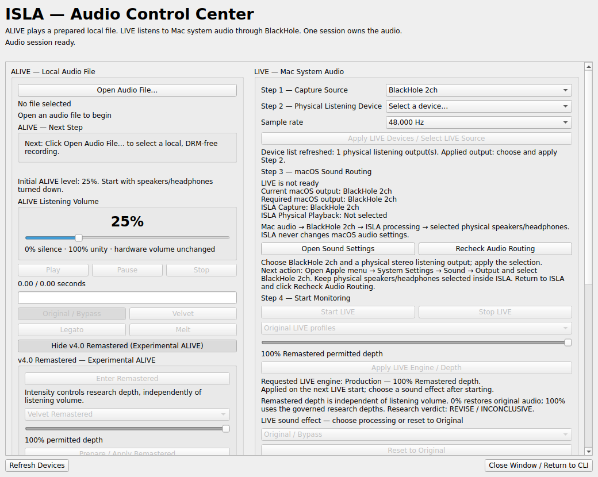
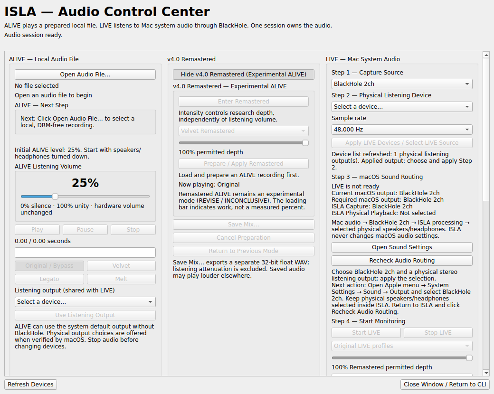

# Audio Control Center: three-column presentation

Baseline: `c2c2023` (main, merged PRs #67 and #68).

Before: ALIVE and its expandable research/export controls occupied the left panel;
LIVE occupied the right panel. After: ALIVE / v4.0 Remastered / LIVE are three equal
columns. The center holds the existing ALIVE research and export widgets. LIVE
engine/depth stays in LIVE. The original 1040 × 830 default size, native styling,
50 ms refresh, and scroll area are retained. LIVE form labels stack above inputs;
routing and export buttons stack vertically to preserve their complete labels.

## Preservation checklist

- All original source string literals retained, including dynamic messages,
  research disclaimers, tooltips and accessibility names.
- Runtime comparison: all 35 named button/combo/slider/progress controls retain
  their types, accessibility names, tooltips and initial enabled states; traditional
  mode buttons remain created by the unchanged `_modes` method.
- File opening, transport, modes, both listening volumes, output selection and
  routing controls retained.
- ALIVE admission, preparation, cancellation, previous-mode restoration and
  Save Mix remain on their original signals. Save/Cancel/Return remain outside
  the collapsible research settings.
- LIVE engine, depth, effects, volume, Mute, Start/Stop, recovery guidance and
  diagnostics retained. No LIVE export added.
- The initial presentation commit changed only layout construction. Event handlers, worker,
  control service, callbacks, DSP, routing, export and research files unchanged.

## Verification

- Existing focused Qt/control/ALIVE/LIVE/Remastered/Save Mix suite:
  **411 passed, 4 environment failures**. Command:
  `QT_QPA_PLATFORM=offscreen python -m pytest -q tests/test_qt_window.py tests/test_control* tests/test_mix_export* tests/test_remastered* tests/test_alive.py tests/test_live.py`
- All four failures reproduce on unchanged baseline: three parametrized
  `test_actual_launch_forms_create_and_close_real_qt_window` cases and
  `test_installed_module_and_console_entrypoints_enter_shell`. This container
  lacks the native PortAudio library and the console entrypoint beside its
  runtime Python. No tests were weakened or skipped to hide these failures.
- Added layout tests: **3 passed**, at 1040 × 830, 800 × 600 and 1440 × 900.
  Verify panel order/non-overlap, ownership, scrolling to controls/diagnostics,
  expand/collapse, Save/Return visibility, unchanged refresh interval and no
  horizontal scrolling at the default size.
- Before/after offscreen screenshots reviewed. Original-string multiset and
  runtime control inventory compared; `git diff --check` passes.

### Subsequent functional acceptance

The branch also contains a **test-only** synchronization change in
`tests/test_live.py` (`f643eac`). The manually pumped recovery-status test uses
its fake stream clock for watchdog time and gates DSP completion during each
callback. It still asserts nonfinite-input silencing, one admitted recovery,
fail-closed repeated capture loss, retained failure counters and processor-error
shutdown. It does not change production monitoring, timing, ring contention or
recovery safeguards. The functional pass repeated this test 200 times successfully;
separate real-clock watchdog, ring contention, starvation and routing-loss tests
remain in the suite. This scheduling test is not native device evidence.

The later [functional acceptance pass](../FUNCTIONAL_ACCEPTANCE.md) adds two
small Qt state-recovery repairs and interaction regressions. Therefore the final
PR is no longer strictly layout-only; audio/DSP/backend implementation is unchanged.

## Deliberate deviations and limitations

The wireframe's shared engine, new workflow, arrows and illustrative wording are
not implemented. Existing ALIVE and LIVE research remain independent. No text is
shortened. Long LIVE guidance/diagnostics require vertical scrolling; narrow
windows can scroll horizontally. Default-size screenshots show the upper portion
of the scrollable content, with research expanded for comparison; initial collapsed
behavior remains unchanged. Native macOS fonts can affect dimensions.

Offscreen tests do not establish physical Mac audio acceptance. Playback and DSP
behavior were not intentionally modified. Existing research REVISE / INCONCLUSIVE
and release HOLD requirements remain. Do not merge, tag, publish or release without
creator approval.
