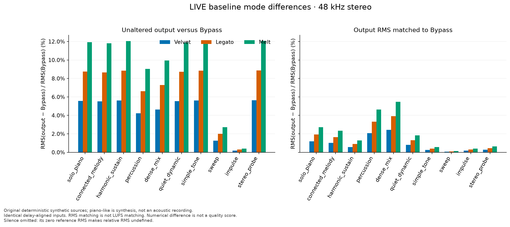
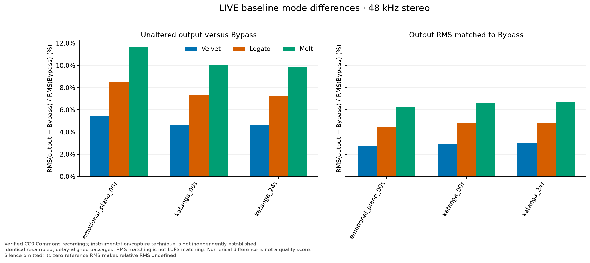

# Mode differentiation results

ISLA — SOL ULTRA · October 24, 2026 · unchanged baseline `4eb2412`

**224 mode/configuration measurements and 336 pairwise comparisons confirm a strength-only structure.** There are measurable residual waveform changes after level matching, especially in the CC0 music. This study contains no new listening verdict and no perceptual-quality score.

## Controlled design

Eleven original deterministic synthetic sources, six seconds each, cover piano-like attacks/decays, connected melody, harmonic sustain, percussion, dense mix, quiet/dynamic passages, silence, impulse, sweep, simple tone and a stereo probe. Piano-like synthesis is not an acoustic piano recording. Oscillators, envelopes, panning and seeded noise are documented by `dsp_study_fixtures.py` and the JSON source manifests.

Two verified CC0 original WAV files add three common musical passages:

| Recording / author | Original format and duration | Measured source passages |
|---|---|---|
| Emotional Piano / triangelx | PCM16 WAV, 44.1 kHz stereo, 16.000 s | 0–12 s |
| Katanga / IDKwhtToptHER | PCM16 WAV, 44.1 kHz stereo, 58.170589569 s | 0–12 s and 24–36 s |

[Provenance, pinned source pages, authors and SHA-256 hashes](study/recordings/RECORDING_PROVENANCE.md) were recorded before incorporation. [Emotional Piano's Commons page](https://commons.wikimedia.org/wiki/File:Emotional_piano.wav), its [credited Freesound original](https://freesound.org/people/triangelx/sounds/189175/), and [Katanga's Commons page](https://commons.wikimedia.org/wiki/File:Katanga.wav) state the licensing. Instrument names do not verify a physical acoustic instrument or capture technique.

Every source is evaluated at 44,100 and 48,000 Hz, mono and stereo, in Bypass/Velvet/Legato/Melt. Every mode receives exactly the same float32 array, fresh identical state and the same zero flush. Mono recording derivatives use the arithmetic L/R mean. Stereo retains original channels. Rate conversion occurs once before all modes using `scipy.signal.resample_poly` (default Kaiser 5.0), with rational up/down factors; no mode uses a different resampler or gain. The converted source array and original-file hashes are recorded in each manifest.

Sources have ≥4096 exact-zero frames at both ends. Recordings receive 0.125 s silence on each side. This isolates complete WOLA comparisons and retains musical transform pre-response/tails; it is not evidence of safe immediate wet startup. Separate deliberately unprimed edge tests measure the entire startup interval.

Streaming uses only the actual `StreamingDSP.process_block` path, fixed 512-frame hops. Append zeros through the 1536-frame delay and partial final hop, then compare `raw[1536:1536+source_frames]`. This removes a known delay, with no correlation-based time warping or per-mode trimming. Assert exact numerical Bypass equality with the converted source. A separate whole-signal overlap-sum reference verifies every wet output with the existing `atol=1e-7, rtol=1e-6`; no tolerance was loosened.

## Metric definitions and limits

- **Relative RMS:** `RMS(y−b)/RMS(b)`, all frames/channels, float64 accumulation; silence has an undefined ratio (`null`), not a zero relative error.
- **RMS-matched residual:** first scale `y` by `RMS(b)/RMS(y)`, then use the same ratio. Pairwise residuals match the first named mode to the second, whose RMS is the denominator. Raw outputs remain untouched.
- **Level:** `20 log10(RMS(y)/RMS(b))`; crest factor is `20 log10(peak/RMS)`.
- **Centroid:** magnitude-weighted frequency over periodic-Hann 2048-frame spectra at 512-frame spacing. **Bands:** fractions of mean spectral power in 0–200, 200–2000, 2000–6000 and 6000–Nyquist Hz. They are descriptors, not calibrated harshness or loudness measures.
- **Envelopes/onsets:** centered 1 ms RMS envelope; raw and RMS-matched envelope residuals; strongest envelope-rise positions matched locally within ±25 ms. Multiple nearby rises can exchange rank, so the onset offsets are diagnostic and not physical event labels or proof of timing drift.
- **Pitch/timing:** autocorrelation F0 on the simple/sustained synthetic probes only, plus whole-passage correlation lag in ±512 samples for all non-silent sources. No pitch estimator on the polyphonic recordings is claimed. Integer lag cannot exclude local modulation or sub-sample effects.
- **Stereo:** whole-passage Pearson L/R correlation; no crossfeed does not guarantee perceptual image preservation. Silence/constant channels have undefined correlation.
- **Seams:** sample-step RMS/max at hop edges compared with all sample steps, plus independent WOLA residuals. A large step can be a legitimate attack or waveform slope; reference agreement is stronger evidence than a step statistic alone.
- **Peaks:** raw and aligned sample peaks/counts above magnitude 1; FLOAT WAV preserves overshoot. Loudness-listening copies also have a 4× oversampled peak probe, which is not a certified true-peak meter.

## Same-passage numerical results

48 kHz stereo; all differences below are percentages of the indicated reference RMS. Columns list Velvet / Legato / Melt. These excerpts are descriptive observations, not statistical estimates over a population of music.

| Source | Raw RMS difference vs Bypass (%) | RMS-matched difference vs Bypass (%) | Melt level change (dB) |
|---|---:|---:|---:|
| solo_piano | 5.56 / 8.74 / 11.92 | 1.19 / 1.93 / 2.72 | -1.075 |
| connected_melody | 5.51 / 8.66 / 11.81 | 1.02 / 1.65 / 2.33 | -1.072 |
| harmonic_sustain | 5.63 / 8.84 / 12.06 | 0.56 / 0.91 / 1.29 | -1.110 |
| percussion | 4.22 / 6.63 / 9.04 | 2.07 / 3.33 / 4.64 | -0.711 |
| dense_mix | 4.64 / 7.29 / 9.94 | 2.44 / 3.92 / 5.48 | -0.766 |
| quiet_dynamic | 5.55 / 8.72 / 11.89 | 0.80 / 1.30 / 1.84 | -1.087 |
| impulse | 0.19 / 0.30 / 0.41 | 0.19 / 0.30 / 0.41 | -0.002 |
| sweep | 1.27 / 2.00 / 2.72 | 0.06 / 0.10 / 0.13 | -0.239 |
| simple_tone | 5.62 / 8.84 / 12.05 | 0.25 / 0.40 / 0.57 | -1.114 |
| stereo_probe | 5.64 / 8.86 / 12.08 | 0.28 / 0.45 / 0.64 | -1.117 |
| emotional_piano_00s | 5.43 / 8.53 / 11.64 | 2.76 / 4.46 / 6.26 | -0.916 |
| katanga_00s | 4.66 / 7.33 / 9.99 | 2.98 / 4.78 / 6.66 | -0.694 |
| katanga_24s | 4.61 / 7.24 / 9.87 | 2.99 / 4.80 / 6.68 | -0.677 |

Silence remains exactly silent in all modes. Simple sustain is largely explained by gain in this metric; the recordings retain appreciable structural waveform differences. It would be inaccurate to call the entire corpus pure attenuation.

### Pairwise separation after RMS matching

48 kHz stereo. The second named mode is the reference denominator.

| Source | Velvet → Legato (%) | Velvet → Melt (%) | Legato → Melt (%) |
|---|---:|---:|---:|
| solo_piano | 0.741 | 1.535 | 0.794 |
| connected_melody | 0.634 | 1.313 | 0.679 |
| harmonic_sustain | 0.352 | 0.729 | 0.377 |
| percussion | 1.256 | 2.570 | 1.313 |
| dense_mix | 1.485 | 3.042 | 1.557 |
| emotional_piano_00s | 1.703 | 3.505 | 1.803 |
| katanga_00s | 1.802 | 3.683 | 1.881 |
| katanga_24s | 1.808 | 3.694 | 1.885 |

Adjacent raw increments share the same waveform direction. The maximum `Legato−(Velvet+Melt)/2` residual is 2.24e-8 full scale for synthesis and 4.47e-8 for recordings. Level matching changes the exact linear relationship but does not create a new algorithmic identity.

### Recording sensitivity across formats

Melt relative RMS / RMS-matched residual, both percentages versus aligned Bypass:

| Rate / channels | Emotional Piano 0–12 s | Katanga 0–12 s | Katanga 24–36 s |
|---|---:|---:|---:|
| 44100 / 1 | 11.75 / 5.61 | 9.65 / 6.62 | 9.66 / 6.50 |
| 44100 / 2 | 11.70 / 5.48 | 10.13 / 6.71 | 9.99 / 6.67 |
| 48000 / 1 | 11.61 / 6.33 | 9.50 / 6.55 | 9.70 / 6.67 |
| 48000 / 2 | 11.64 / 6.26 | 9.99 / 6.66 | 9.87 / 6.68 |

## Tonal, transient, pitch and stereo observations

At 48 kHz stereo, Melt changes the synthetic dense-mixture centroid from 5029.54 to 5186.87 Hz (+3.13%); percussion rises from 12554.62 to 12667.66 Hz. The CC0 changes are smaller: Emotional Piano 757.91→760.79 Hz; Katanga 0 s 3446.27→3455.80 Hz; Katanga 24 s 3217.25→3224.25 Hz. These increases refute a universal brightness-reduction interpretation of the existing operation. All band-energy fractions are in CSV/JSON; neither the centroid nor a band fraction establishes perceived harshness.

Raw envelope changes include level attenuation. The matched-envelope Melt residuals at 48 kHz stereo are about 2.09% on piano-like synthesis, 1.95% on connected melody, 4.04% on percussion and 3.85% on dense mixture. The impulse changes only about 0.41% raw waveform RMS: a flat-magnitude transient is nearly a fixed point, so no generic attack-softening claim follows. Crest and onset diagnostics are retained, including ±15–25 ms local-rise reassignments on some melodic sources; these are not recast as note timing shifts.

All non-silent controlled sources have a whole-passage maximum-correlation lag of zero samples after fixed delay alignment. In the 48 kHz mono probes, ACF F0 is about 440.019016→440.019065 Hz for simple tone and 110.004136→110.003943 Hz for harmonic sustain (Bypass→Melt). This finds no gross pitch/timing displacement in these probes, not a universal no-pitch-change proof. The coefficient-phase/null limitation remains.

Whole-passage correlation deltas reach |0.002575| in synthesis and |0.015871| in the recordings. No channels are mixed. Listening remains necessary to evaluate image quality, especially local changes hidden by a whole-passage statistic.

Independent WOLA comparison maximum error is 1.49e-8 for the synthetic corpus; recording results are supplied in the data. Agreement includes every output seam in the aligned interval and supports correct retained overlap, without proving that the underlying modified-STFT algorithm is artifact-free.

## Clipping and edge findings

No guarded synthetic output exceeds full scale. Original Katanga contains samples at the PCM16 limits; reaching a limit alone does not prove distortion. The 48 kHz resampled stereo 24–36 s source has peak **1.0132376** and two samples above magnitude 1, already in Bypass. This comes from the documented source conversion, not LIVE DSP. It is preserved in the raw FLOAT measurement; none of that passage's wet renders exceed 1 in this corpus. Original 44.1 kHz source bytes remain unchanged.

Separate immediate-start probes expose a **DSP baseline startup risk**: a peak-0.5 constant input yields Melt peak 1.238757 at 44.1 kHz / 1.135527 at 48 kHz before delayed dry onset. A 20 Hz cosine also exceeds full scale. Warm silent pre-roll removes that amplification in the tested cases. Tiny perturbations at exact-bin nulls can change wet outputs by 10–12%. See [mathematical explanation](LIVE_DSP_BASELINE_ANALYSIS.md) and [all edge records](study/baseline_edge_cases.json). These failures remain visible despite passing existing regression tests.

## Worker time and memory

Measured on Apple Silicon macOS 26.7.2, Python 3.14.6 / NumPy 2.5.4. Timing covers the worker body's finite scans, RMS meters, all three warm banks and bounded ring access. A separate spawn barrier ensures two FFT/Python CPU competitors are active before loaded measurements. Each throughput cell retains 3000 timings after 32 warmup hops. The paced cell retains 1200 timings (~12.8 s) at 48 kHz stereo under the same competing load.

| Load / rate / channels | p50 / p99 / p99.9 (ms) | Maximum (ms) | Hop budget (ms) | Body overruns |
|---|---:|---:|---:|---:|
| Ambient / 44100 / 1 | 0.127 / 0.150 / 0.163 | 0.238 | 11.610 | 0 |
| Ambient / 44100 / 2 | 0.206 / 0.252 / 0.346 | 0.361 | 11.610 | 0 |
| Ambient / 48000 / 1 | 0.127 / 0.149 / 0.159 | 0.211 | 10.667 | 0 |
| Ambient / 48000 / 2 | 0.204 / 0.237 / 0.254 | 0.258 | 10.667 | 0 |
| CPU competitors / 44100 / 1 | 0.132 / 0.159 / 0.238 | 0.246 | 11.610 | 0 |
| CPU competitors / 44100 / 2 | 0.215 / 0.245 / 0.304 | 0.325 | 11.610 | 0 |
| CPU competitors / 48000 / 1 | 0.133 / 0.164 / 0.219 | 0.259 | 10.667 | 0 |
| CPU competitors / 48000 / 2 | 0.215 / 0.246 / 0.297 | 0.338 | 10.667 | 0 |
| CPU competitors paced / 48000 / 2 | 0.247 / 0.391 / 0.420 | 0.891 | 10.667 | 0 |

Paced wakeup lateness p99 / maximum was **2.580 / 2.614 ms**; combining each wakeup delay with its measured body time produced **0 completion-deadline misses** in this short model. This is a distribution, not a hard-real-time guarantee.

The model excludes the native callback/GIL schedule, periodic routing validation, audio backend and hardware. Rings are drained every modeled hop, so their high-water 1 does not establish actual native queue behavior. No actual browser workload or 30-minute stress session was run. These explicit CPU competitors are a reproducible load screen, not a substitute for realistic native acceptance.

Retained DSP NumPy arrays remain **108,576 bytes mono / 180,256 stereo**, plus two rings including timestamp arrays **32,896 / 65,664 bytes**. Parent process peak RSS was **248.5 MiB**, including complete fixture creation; it is neither DSP scratch size, a memory-growth measurement nor child-process memory. The 2000-hop safety matrix confirms fixed retained-array sizes, not universal allocator/RSS bounds.

## Listening artifacts and evidence boundary

**28 integrated-loudness-matched stereo WAVs** cover four synthetic sources and all three CC0 passages, with all four modes on each. `pyloudnorm==0.2.0` uses its default K-weighted gated 400 ms integrated meter. This follows the loudness approach described by [ITU-R BS.1770](https://www.itu.int/rec/R-REC-BS.1770-5-202311-I/) and the [library's primary implementation](https://github.com/csteinmetz1/pyloudnorm/blob/master/pyloudnorm/meter.py); this study is not a meter conformance certification.

Every passage shares a target at or below Bypass minus 3 LU and −23 LUFS, with common headroom reduction if needed. Both channels receive the same fixed gain; there is no limiter or dynamic processing. Saved files were remeasured: target errors are below 1e-8 LU and maximum 4× oversampled peak probe is below 0.291. This controls integrated loudness, not every aspect of human loudness perception. Raw and separate RMS-matched copies are retained for analysis.

Use the [listening guide](LISTENING_GUIDE.md). No sample was played automatically; no native capture, device route, volume or monitor state was changed. No new owner preference, ABX result, acoustic latency, or audible improvement is claimed. Historical Melt preference remains useful subjective evidence at its recorded earlier commit.

## Data and reproduction

- [Synthetic measurements JSON](study/measurements.json), [CSV](study/measurements.csv), [pairwise CSV](study/pairwise.csv), [source hashes](study/fixtures.csv).
- [Recording measurements JSON](study/music/measurements.json), [CSV](study/music/measurements.csv), [pairwise CSV](study/music/pairwise.csv), [source hashes](study/music/fixtures.csv).
- [Edge cases](study/baseline_edge_cases.json), [safety matrix](study/safety.json), [budget distributions](study/benchmark.json).
- PNG and editable SVG plots accompany both corpora; exact dependency/environment details are in JSON.
- [Reproduction instructions](REPRODUCE.md) and the supplied research-code archive retain the unchanged baseline and all study commands.

Fixed seeds and recorded input hashes make comparisons deterministic within the recorded environment. FFT/library/platform differences can change roundoff, especially at spectral nulls; cross-environment bit identity of generated audio is not asserted.
