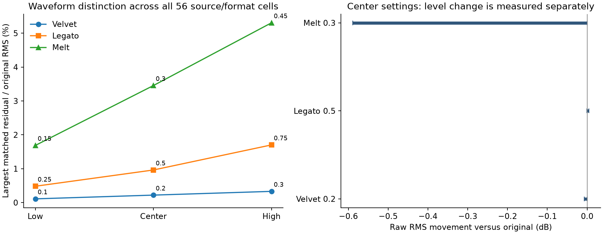

# Candidate Comparison Matrix

All comparisons use unchanged v3.1.0, commit `6a732e03c3f0adc3f555e0ecb002e365b7e3385f`.
Each row covers 14 sources × two rates × two channel counts = 56 cells.
The 14 sources are 11 inherited generated fixtures, near-silence, a gapped tone,
and one checksum-verified CC0 piano recording. No subjective score is assigned.

| Profile | Amount | Raw RMS movement vs original (dB) | RMS-matched waveform residual / original RMS | Largest picked attack shift (ms) | Failed cells |
|---|---:|---:|---:|---:|---:|
| Velvet | 0.10 | -0.0034 to -0.0000 | 0.0016–0.1103% | 0.023 | 0/56 |
| Velvet | 0.20 | -0.0067 to -0.0000 | 0.0033–0.2207% | 0.023 | 0/56 |
| Velvet | 0.30 | -0.0101 to -0.0000 | 0.0049–0.3311% | 0.023 | 0/56 |
| Legato | 0.25 | -0.0006 to +0.0022 | 0.0000–0.4825% | 17.188 | 1/56 |
| Legato | 0.50 | -0.0007 to +0.0044 | 0.0000–0.9623% | 17.188 | 1/56 |
| Legato | 0.75 | -0.0009 to +0.0071 | 0.0000–1.7023% | 17.188 | 1/56 |
| Melt | 0.15 | -0.2894 to -0.0000 | 0.0083–1.6875% | 0.023 | 0/56 |
| Melt | 0.30 | -0.5888 to -0.0001 | 0.0166–3.4548% | 10.204 | 1/56 |
| Melt | 0.45 | -0.8988 to -0.0001 | 0.0250–5.3064% | 10.204 | 2/56 |

The original mode compared with itself has 0 dB movement, zero residual and zero
picked shift. Every original is also compared with Bypass in the full dataset.
Residuals measure waveform distinction after removing one whole-passage RMS
gain; they do not measure quality or audibility. Silence ratios are undefined
and omitted from ranges. The center amounts were fixed before measurements.
Melt .15 was added to the showcase after screening; it is a separate supplement.

Six failed cells all come from the recorded piano: Legato .25/.50/.75 at
44.1 kHz stereo (−17.188 ms picked slope change); Melt .30/.45 at 44.1 kHz mono
(−10.204 ms); Melt .45 at 44.1 kHz stereo (+10.068 ms). All remain failed under
the registered 1 ms screen. Competing envelope peaks, rather than a demonstrated
waveform delay, explain the diagnostic pattern; this does not waive the screen.

## Representative 48 kHz stereo comparisons

Values below use the recorded piano and each original mode as its reference.

| Profile / amount | Raw RMS movement | Matched residual | Stereo correlation movement |
|---|---:|---:|---:|
| Velvet / 0.20 | -0.0052 dB | 0.1282% | +0.000063 |
| Legato / 0.50 | -0.0001 dB | 0.5156% | +0.000589 |
| Melt / 0.15 | -0.2000 dB | 1.6875% | -0.001825 |
| Melt / 0.30 | -0.4020 dB | 3.4548% | -0.003810 |

Velvet .20 lowers generated-passage spectral centroids by approximately
0–10.08 Hz at 48 kHz stereo (near-zero movement on a pure tone), with small
upper-band fraction reductions on rich material. That supports the intended
frequency bias, not a harshness or warmth verdict. Melt can increase upper-band
fraction on percussion despite lowering raw RMS. Legato can increase centroid
on a dense mix. The names do not predict a uniform spectral or musical result.

The complete [CSV](evidence/comparison.csv) and [generated](evidence/generated-measurements.json)
and [recorded](evidence/recorded-measurements.json) datasets retain RMS, peaks,
band fractions, centroid, waveform lag, envelope roughness, attack observations,
stereo correlation, balance, pitch, gap checks and aligned float32 hashes.

