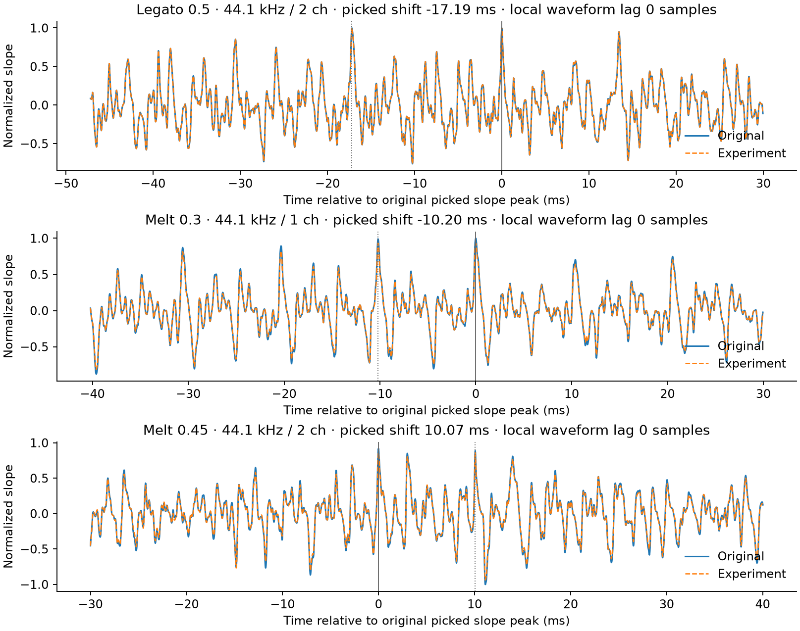

# Musical Identity Research Report

ISLA · SOL EXTRA HIGH · Experiment 01 · October 24, 2026 · Research only

**Result:** Three isolated experiments were implemented and measured. No audible
improvement, owner preference, or independent musical identity is established.
Velvet and low-depth Melt pass the numerical screens. Legato and higher Melt
amounts have unresolved recorded-piano attack-screen failures. Keep production
defaults unchanged and use the supplied comparisons for creator evaluation.

## Verified baseline and scope

The requested v3.1.0 baseline is the verified lightweight tag at
[`6a732e03c3f0adc3f555e0ecb002e365b7e3385f`](https://github.com/dfeen87/ISLA/commit/6a732e03c3f0adc3f555e0ecb002e365b7e3385f).
Its Python, CMake and public version metadata say 3.1.0. Current `main` was
separately verified at `14d91646b51a383da8839e4885e826808d399829`, version 3.1.1.
PRs #25–26 supplied the numerical corrections and version alignment; #27–28
addressed simulated-clock testing and routing guidance. Subsequent #29–31
introduced capture recovery, 3.1.1 metadata and README badges. The main/tag
comparison confirms no subsequent change to streaming.py, spectral.py or the
harmonic kernel. This experiment starts from the explicitly requested tag;
it does not roll back or modify main or its recovery behavior.

One dedicated branch, `research/musical-identity-lab-01`, contains additive
research tools, tests and evidence. Production DSP, ALIVE/offline behavior,
2048/512 framing, 1536-sample delay, routing safeguards, 5 ms mode fades,
warm banks, complete startup weights, and bounded spectral reconstruction
remain byte-for-byte unchanged. Original research and audio evidence remain
untouched. No native device, routing, merge, version, tag or release operation
was performed. No production implementation PR was opened.

## Hypotheses and controlled method

The original three modes are one three-bin smoothing operation at strengths
.35/.55/.75. Research adapters add one isolated change to one bank at a time:

| Profile | Hypothesis | Parameter sweep |
|---|---|---|
| Velvet | Smooth frequency-weighted local curvature could alter upper-partial texture with less low-band movement | Depth .10/.20/.30, fixed 3 kHz weighting knee |
| Legato | A bounded history of spectral shaping transfer could reduce frame-to-frame timbral variation | Memory coefficient .25/.50/.75 |
| Melt | Five-bin binomial envelope shaping could yield a broader texture change | Depth .15/.30/.45 |

These are envelope experiments, not harmonic tracking, note detection or pitch
shifting. A common stereo control drives the added per-bin gain. Fixed spectral
novelty and decay gates return attacks and rapid decay toward the original bank;
exact silence clears memory. An attenuation-only frame-energy cap prevents
upward normalization. The phase reference remains current and unchanged.
Frame-energy control is not a bound on arbitrary sample or intersample peaks.
The premeasurement [protocol](PROTOCOL.md) records equations, constants and gates.

The study includes 224 original/Bypass records and 504 candidate records from
56 source/format cells. Sources cover changing piano-like attacks, connected
tones, sustained harmonics, percussion, dense mixtures, stereo partials, silence,
near-silence, impulses, sweeps, pitch and a controlled gap. The supplemental
recording is **Emotional Piano** by triangelx, labeled CC0 on its
[original Freesound page](https://freesound.org/people/triangelx/sounds/189175/).
Its exact source SHA-256 is verified; the physical instrument and recording
method are not independently known. The generated sources use mathematical
oscillators/envelopes and seeded noise without third-party samples.

## Findings and interpretation

Velvet .20 produces at most 0.221% RMS-matched waveform residual versus its
original over this corpus. Its frequency bias is measurable, but small. A more
distinct or preferable warmth/softness is unproven. Legato .50 reaches 0.962%
matched residual; on connected melody its matched envelope roughness declines
only about 0.018–0.023%. That weak proxy does not support a meaningful connection
claim. At .75 the reduction remains below 0.083%.

Melt .30 reaches 3.455% matched residual and up to 0.589 dB raw attenuation;
level matching leaves a measurable difference, so the change is not exclusively
whole-file gain. More difference is not evidence of more flow. Low Melt .15
reaches 1.688% residual and passes every registered screen. It is included as
an explicitly post-screen option; the preselected .30 center is retained.

All generated-fixture cells passed the screens. The piano recording exposed
six picked-attack failures: all Legato amounts at 44.1 kHz stereo, and higher
Melt in selected 44.1 kHz configurations. The picked envelope-slope changes are
10–17 ms. Diagnostic windows have local waveform correlation lag of zero;
already close slope peaks change ranking (within about 0.13%, 0.94% and 3.32%
in the original examples). This suggests detector ambiguity under changed
timbre, not a demonstrated delay of the whole attack. The failures remain
unresolved: thresholds were not relaxed and no candidate was retuned to pass.

No samples at or above full scale, nonfinite output, persistent gap fill, pitch-screen failure or
stereo-screen failure was found on this corpus. Original Bypass is exact and
every sweep amount meets the existing 1% near-null perturbation bound. These
are bounded software observations, not guarantees for arbitrary audio.

## Recommendations

* **Velvet: revise as an identity proposal.** Preserve this safe, small change
  as a reference. Obtain a neutral listening judgment before designing a more
  consequential frequency-aware experiment; no musical benefit is established.
* **Legato: reject these amounts for promotion; revise the hypothesis.** The
  continuity proxy barely changes and attack screening remains unresolved.
  Diagnostic listening may inform a new, separately registered experiment.
* **Melt: retain .15 for creator research evaluation.** Reject .30/.45 for
  promotion under the current screen. Keep their labeled diagnostic samples.
  Even .15 needs creator discrimination/preference evidence and broader
  transient and stereo assessment before further engineering.

## Practical limits and next decision

The added dataset is short and predominantly synthetic; one CC0 recording is
not a broad musical corpus. Attack estimators and spectral/envelope proxies are
not perception models. Browser switching can insert a playback gap unrelated
to DSP. Loudness matching does not make momentary loudness or tonal balance
identical. The 4× peak probe is not a certified true-peak meter. State and
worker measurements omit native scheduling, physical buffering and acoustics.

The [listening guide](CREATOR_LISTENING_GUIDE.md) separates hearing a difference,
preferring a result, and choosing a name. Record those independently. Retain
the baseline if no repeatable benefit emerges; do not force three new identities.
Any later accepted change needs a new engineering review and its own acceptance
work. This package authorizes no promotion, merge or release.
